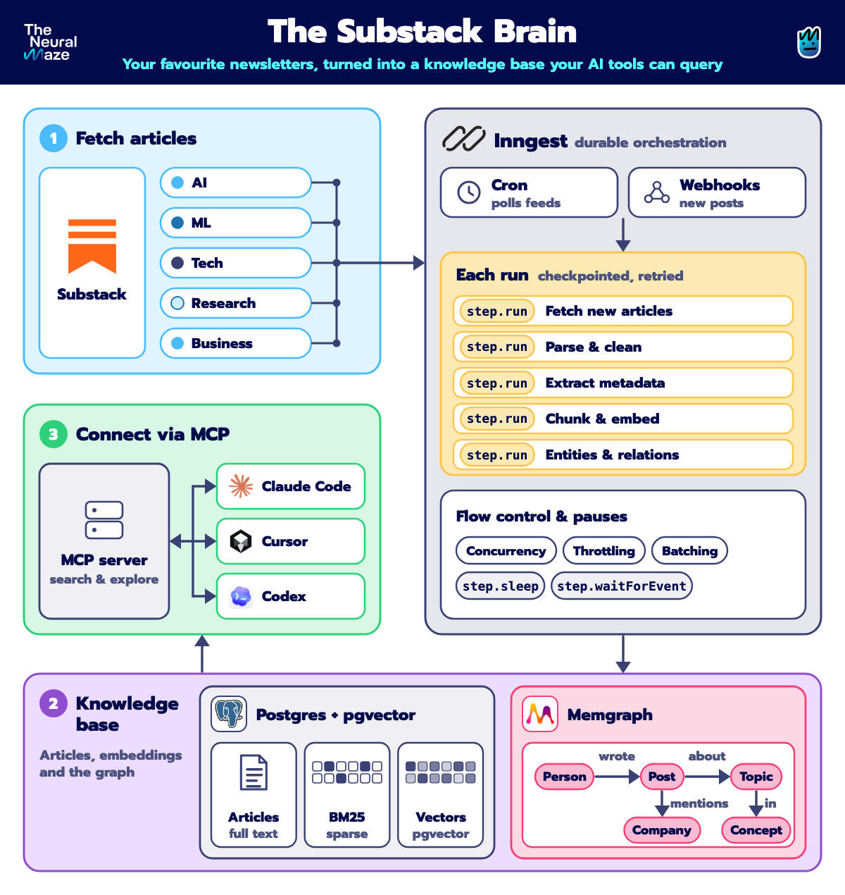
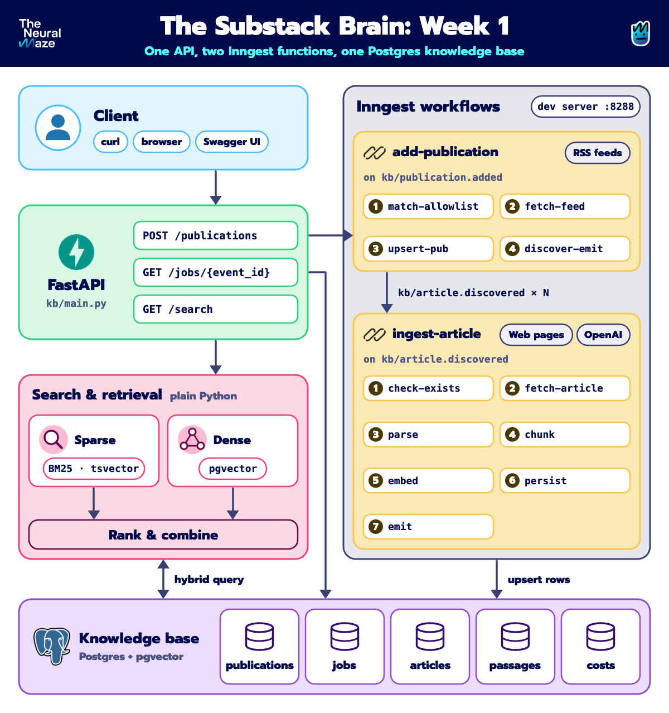
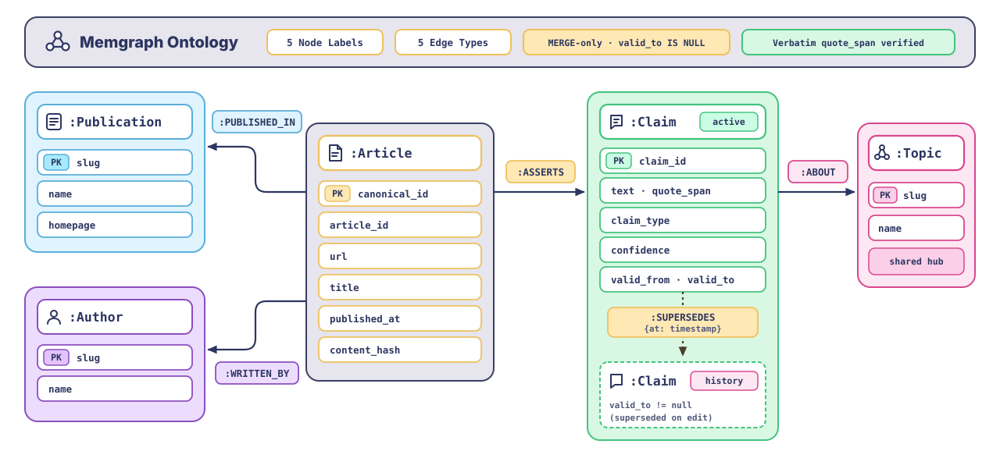

<div align="center">
  <h1>The Substack Brain</h1>
  <h3>Build a second brain from your favourite newsletters, one your AI tools can search, cite and reason over</h3>
</div>

</br>

<p align="center">
    <a href="static/course_overview.png"></a>
</p>


## Table of Contents

- [Table of Contents](#table-of-contents)
- [Course Overview](#course-overview)
- [Who is this course for?](#who-is-this-course-for)
- [Course Breakdown: Week by Week](#course-breakdown-week-by-week)
- [Getting Started](#getting-started)
- [Working with the project](#working-with-the-project)
- [Week 1: Your first durable pipeline](#week-1-your-first-durable-pipeline)
- [Week 2: Three newsletters, flow control and answers with citations](#week-2-three-newsletters-flow-control-and-answers-with-citations)
- [Week 3: Conditional freshness, temporal supersession and an MCP server](#week-3-conditional-freshness-temporal-supersession-and-an-mcp-server)
- [Week 4: Structured claim extraction, Memgraph ontology and three-way RRF](#week-4-structured-claim-extraction-memgraph-ontology-and-three-way-rrf)
- [Week 5: An evaluation suite built from your system's failures](#week-5-an-evaluation-suite-built-from-your-systems-failures)
- [Our Sponsor](#our-sponsor)
- [Contributors](#contributors)


## Course Overview

This isn't your typical "call an LLM and print the result" tutorial. Most tutorials stop at the happy path. This course is about everything around it, the layer that decides whether a system survives a real Tuesday: **durable execution, retries that don't double-bill an API, idempotency, and evaluation built from real failures**.

So instead of a demo, we're building a real product: **The Substack Brain**, a knowledge base that turns technical newsletters into something your AI tools can query. It reads the articles, keeps itself fresh, understands who said what, and answers with citations. All of it runs on [Inngest](https://inngest.link/neural-maze-gh), the durable orchestration engine that makes it survive real-world failures.

By the end of this course, you'll have a system capable of:

* 📬 Ingesting newsletters straight from their RSS feeds, safely, from an allowlist
* ⚙️ Running every pipeline as **durable [Inngest](https://inngest.link/neural-maze-gh) steps** that survive crashes, retries and rate limits
* 🔎 Searching with **hybrid retrieval**: BM25 and dense vectors fused into one ranking, inside Postgres
* 💬 Answering questions with **citations** you can click and verify
* ⏱️ Staying fresh with a poller that costs almost nothing when nothing has changed
* 🕸️ Extracting who said what into a **Memgraph** knowledge graph
* 🔌 Plugging into **Claude Code, Cursor and Codex** through an MCP server
* 📊 Measuring quality with **evals built from your own failures**, not vibes
* 🤖 Running a bounded research agent and a weekly digest, deployed for real

We start absurdly simple (one newsletter, five articles, one Postgres table) and add one hard problem every week. **Weeks 1 to 5 are available now.**

Excited? Let's get started!

---

<table style="border-collapse: collapse; border: none;">
  <tr style="border: none;">
    <td width="20%" style="border: none;">
      <a href="https://theneuralmaze.substack.com/" aria-label="The Neural Maze">
        
      </a>
    </td>
    <td width="80%" style="border: none;">
      <div>
        <h2>📬 Stay Updated</h2>
        <p><b><a href="https://theneuralmaze.substack.com/">Join The Neural Maze</a></b> and learn to build AI Systems that actually work, from principles to production. Every Wednesday, directly to your inbox. Don't miss out!</p>
      </div>
    </td>
  </tr>
</table>

<p align="center">
  <a href="https://theneuralmaze.substack.com/">
    
  </a>
</p>

---

## Who is this course for?

This course is for Software Engineers, ML Engineers, and AI Engineers who can already write the happy path (call an LLM, chunk some text, stand up a FastAPI endpoint) and want to understand what separates that from a system you can actually leave running.


## Course Breakdown: Week by Week

Each week, you'll unlock **a new chapter of the journey**. We start absurdly simple (one newsletter, five articles, one Postgres table) and add exactly one hard problem per week. You'll get:

* 🧾 A Substack article that walks through the concepts and code in detail
* 💻 A new batch of code pushed directly to this repo
* 🎥 A video that explores the topic

Here's what the weeks look like 👇

| Week | 🛠️ You'll build | 🧾 Article | 💻 Code | 🎥 Video |
|:----:|:----------------|:----------:|:-------:|:--------:|
| <div align="center">1</div> | ⚙️ A durable RSS importer, triggered over plain HTTP, plus a first look at sparse and dense retrieval | [Week 1](https://www.theneuralmaze.com/p/durable-harnesses-for-graph-powered) | [Week 1](docs/week-1.md) | Coming soon |
| <div align="center">2</div> | 📚 Backfilling three newsletters with concurrency, throttling and priority, hybrid retrieval, a first LLM answer with citations | [Week 2](https://www.theneuralmaze.com/p/the-ai-engineers-guide-to-scaling) | [Week 2](docs/week-2.md) | Coming soon |
| <div align="center">3</div> | 🔄 A conditional freshness poller, article edits that keep citation history, a failures dataset and an MCP server | [Week 3](https://theneuralmaze.substack.com/p/temporal-versioning-for-production) | [Week 3](docs/week-3.md) | Coming soon |
| <div align="center">4</div> | 🕸️ Claim extraction into a Memgraph graph, quote-span guardrail, 3-way RRF fusion and `kb_sources` | Coming soon | [Week 4](docs/week-4.md) | Coming soon |
| <div align="center">5</div> | 📊 An evaluation suite built from your system's failures: open/axial coding, deterministic guardrails, TPR/TNR calibrated binary judges, and Inngest variant experiments | Coming soon | [Week 5](docs/week-5.md) | Coming soon |
| <div align="center">6</div> | 🤖 A bounded research agent, a weekly digest and a production deploy | Coming soon | Coming soon | Coming soon |

---

## Getting Started

Before diving in, make sure you have:

1. 🐳 [Docker](https://docs.docker.com/get-docker/) running
2. 📦 [uv](https://docs.astral.sh/uv/) installed
3. 🔑 An [OpenAI API key](https://platform.openai.com/api-keys) with a little credit (used for embeddings; the whole of week 1 costs a few cents)
4. 🔑 *(From week 2, optional)* An [Anthropic API key](https://console.anthropic.com/) for the answers written by `POST /ask` and `kb_ask`. Without it, they return the retrieved passages only.

Then set up the project:

```bash
git clone https://github.com/neural-maze/substack-brain-course.git
cd substack-brain-course
cp .env.example .env        # fill in OPENAI_API_KEY (ANTHROPIC_API_KEY is optional)
```

Each week builds on the previous one, so follow them in order!

---

## Working with the project

### Tools for looking inside

| Tool | URL | For |
|---|---|---|
| **Adminer** | `localhost:8081` | Browse Postgres and watch rows land in `articles`, `passages`, and `claims`. |
| **Inngest dev server** | `localhost:8288` | Every function, run and step, with its timeline and retries. |
| **Memgraph Lab** | `localhost:3000` | Visual graph explorer for Cypher queries over `:Publication`, `:Author`, `:Article`, `:Claim`, and `:Topic` nodes. |
| **Swagger UI** | `localhost:8000/docs` | Try every endpoint from the browser. |

### Useful commands

```bash
make check     # lint (ruff + mypy) and tests
make stop      # docker compose down (your data is kept)
make db-clear  # destructive: empties every table and Memgraph, keeps the schema
make reset     # destructive: docker compose down -v, drops all data
make nuke      # destructive: reset, plus kills a stray app process on the port
```

### Repository layout

- `kb/`: the pipeline (`functions/` for Inngest, `agents/` for hand-written agent steps, `graph/` for Memgraph ontology & Cypher, `evals/` for deterministic checks, binary LLM judges & TPR/TNR calibration, `sources/` for fetch/parse/chunk/embed/quote-validation, `db/`, `retrieval/`, `schemas/`, `mcp/` for the MCP server)
- `evals/`: failure taxonomy (`taxonomy.yaml`), human-labeled traces (`labeled_traces.jsonl`), and the retrieval variant benchmark (`golden_benchmark.yaml`)
- `publications.yaml`: the allowlist of feeds the pipeline may ingest
- `alembic/`: database migrations
- `infra/docker-compose.yml`: Postgres (pgvector), Adminer, Inngest dev server, Memgraph, Memgraph Lab
- `docs/week-1.md`, `docs/week-2.md`, `docs/week-3.md`, `docs/week-4.md`, `docs/week-5.md`: the step-by-step guides
- `scripts/replay_backfill.py` & `scripts/calibrate_judges.py`: replay verifier and TPR/TNR binary judge calibration CLI
- `tests/`: the unit tests, which need no Docker or API keys
- `tests/integration/`: tests that need the stack from `make start` running (they are skipped otherwise)

---

## Week 1: Your first durable pipeline

<p align="center">
    <a href="static/week_1_architecture_detailed.png"></a>
</p>

**Goal**: Build a pipeline that survives being killed mid-task, and search what it ingested.

### Steps:

1. 📖 **Read the guide**: Start with [`docs/week-1.md`](docs/week-1.md). It explains what Inngest is, what each container does, and why the pipeline is split into seven steps.
2. 🚀 **Start the system**:

   ```bash
   make start
   ```

   This starts Postgres, Adminer and the Inngest dev server with Docker Compose, runs the migrations, and launches the FastAPI app. It stays in the foreground, so use a second terminal for the rest.

3. 📥 **Ingest a newsletter** with plain HTTP:

   ```bash
   curl -X POST localhost:8000/publications \
     -H "Content-Type: application/json" \
     -d '{"feed_url": "https://theneuralmaze.com/feed"}'
   # → {"event_id": "...", "trace_url": "http://localhost:8288/event/...", "status": "queued"}

   curl localhost:8000/jobs/<event_id>
   # → {"status": "completed", "articles_done": 5, "articles_total": 5, ...}
   ```

4. 🔎 **Search it**:

   ```bash
   curl "localhost:8000/search?q=agents&mode=sparse"   # BM25 (Postgres full-text)
   curl "localhost:8000/search?q=agents&mode=dense"    # pgvector cosine similarity
   ```

   Try the same query in both modes and compare the results. They won't agree.

5. 💥 **Kill it and watch it resume**: Press Ctrl+C while the `embed` step is running, run `make start` again, and open the run in the Inngest UI. Only `embed` runs again. The guide walks you through it.

6. 🧪 **Run the tests**:

   ```bash
   make test
   ```

   The tests live in [`tests/test_basics.py`](tests/test_basics.py). They need no Docker, database or API key and run in about a second. They cover the small functions the pipeline is built from: URL cleanup, the allowlist, chunking and RSS parsing.

---

## Week 2: Three newsletters, flow control and answers with citations

**Goal**: Ingest three newsletters at once without hammering their servers or your OpenAI quota, let urgent articles skip the queue, and answer questions with hybrid retrieval and inline citations.

### Steps:

1. 📖 **Read the guide**: [`docs/week-2.md`](docs/week-2.md) explains the backfill, the three flow-control knobs on `ingest-article` (concurrency, throttle, priority), Reciprocal Rank Fusion and the context snapshots.
2. 🔑 **Add your Anthropic key**: `POST /ask` uses `ANTHROPIC_API_KEY` to write the answer. Without it, `/ask` still runs retrieval and returns the passages.
3. 🚀 **Start the system** with `make start`. It applies this week's migration (the `snapshots` table) automatically.
4. 📥 **Backfill three newsletters at once**:

   ```bash
   curl -X POST localhost:8000/publications -H "Content-Type: application/json" -d '{"feed_url": "https://theneuralmaze.com/feed"}'
   curl -X POST localhost:8000/publications -H "Content-Type: application/json" -d '{"feed_url": "https://www.decodingai.com/feed"}'
   curl -X POST localhost:8000/publications -H "Content-Type: application/json" -d '{"feed_url": "https://magazine.sebastianraschka.com/feed"}'
   ```

5. ⏩ **Jump the queue** while the backfills run:

   ```bash
   curl -X POST localhost:8000/articles -H "Content-Type: application/json" -d '{"url": "<a Neural Maze post URL>"}'
   ```

6. ❓ **Ask a question**:

   ```bash
   curl -X POST localhost:8000/ask -H "Content-Type: application/json" \
     -d '{"question": "How do durable execution engines handle failure recovery?"}'
   ```

7. 🔁 **Prove replays are free**: `uv run python scripts/replay_backfill.py --verify`, then `--all`, then `--verify` again. Every count stays the same, including the number of embedding calls.

---

## Week 3: Conditional freshness, temporal supersession and an MCP server

**Goal**: Keep the knowledge base fresh without hammering the feeds, handle article edits without breaking old citations, record every failure for the evals, and let Claude Code and Cursor use the knowledge base through MCP.

### Steps:

1. 📖 **Read the guide**: [`docs/week-3.md`](docs/week-3.md) explains the asymmetry principle behind the MCP tools, conditional polling with `ETag` and `Last-Modified`, temporal supersession with `valid_to`, and the `failures` table.
2. 🚀 **Start the system** with `make start`. It applies this week's migration (the `failures` table and a partial unique index on `passages`) automatically.
3. 🔄 **Poll the feeds twice**:

   ```bash
   curl -X POST localhost:8288/e/local -H "Content-Type: application/json" -d '{"name": "kb/feed.poll", "data": {}}'
   ```

   The first poll gets `200 OK` and saves the validators to `cursors`. The second gets `304 Not Modified` and finishes in milliseconds without downloading or parsing any feed.

4. ✏️ **Simulate an article edit**: Ingest an article, change its `content_hash` in Postgres, and submit it again. The old passages get `valid_to` set, the new ones are inserted, and search only returns the current version. The guide has the exact commands.
5. 💥 **Record a failure**:

   ```bash
   curl -X POST localhost:8288/e/local -H "Content-Type: application/json" \
     -d '{"name": "inngest/function.failed", "data": {"error": {"message": "Simulated failure"}, "function_id": "ingest-article"}}'
   ```

   `handle-function-failed` saves it to the `failures` table, ready for the week 5 evals.

6. 🔌 **Connect the MCP server**: Try it with `npx @modelcontextprotocol/inspector uv run kb-mcp`, then add it to Claude Code or Cursor:

   ```json
   {
     "mcpServers": {
       "substack-brain": {
         "command": "uv",
         "args": ["--directory", "/absolute/path/to/substack-brain-course", "run", "kb-mcp"]
       }
     }
   }
   ```

   Reads (`kb_search`, `kb_ask`, ...) answer in under a second. Writes (`kb_add_publication`, `kb_backfill`, `kb_sync`) send an Inngest event and return a trace URL right away.

7. 🧪 **Run the tests** with `make check`. The new tests are in [`tests/test_week3.py`](tests/test_week3.py).

---

## Week 4: Structured claim extraction, Memgraph ontology and three-way RRF

<p align="center">
    <a href="static/week_4_ontology.svg"></a>
</p>

**Goal**: Design a strict 5-node, 5-edge knowledge graph ontology in Memgraph, verify every extracted claim against a verbatim quote span in Python before persistence, fuse 2-hop graph traversal with BM25 and pgvector via three-way RRF, and expose full claim/passage lineage through `kb_sources`.

### Steps:

1. 📖 **Read the guide**: [`docs/week-4.md`](docs/week-4.md) walks through Prerequisite Zero (locking the ontology before code), deterministic topic canonicalization, the hand-written agent layer (`kb/agents/`), the verbatim quote guardrail, and three-way Reciprocal Rank Fusion.
2. 🚀 **Start the system** with `make start`. It launches Memgraph (`localhost:7687`) and Memgraph Lab (`localhost:3000`), and applies the Week 4 migration (`claims` table).
3. 📥 **Ingest or update an article** to trigger `extract-claims`:

   ```bash
   curl -X POST localhost:8000/articles -H "Content-Type: application/json" \
     -d '{"url": "https://www.theneuralmaze.com/p/the-complete-guide-to-event-driven"}'
   ```

   Watch `extract-claims` run in the Inngest UI (`localhost:8288`) and emit `kb/claims.extracted`.
4. 🕸️ **Explore the ontology in Memgraph Lab** (`http://localhost:3000`):

   ```cypher
   MATCH (a1:Author)<-[:WRITTEN_BY]-(art1:Article)-[:ASSERTS]->(c1:Claim)-[:ABOUT]->(t:Topic)<-[:ABOUT]-(c2:Claim)<-[:ASSERTS]-(art2:Article)-[:WRITTEN_BY]->(a2:Author)
   WHERE c1.valid_to IS NULL AND c2.valid_to IS NULL AND a1.slug <> a2.slug
   RETURN a1, art1, c1, t, c2, art2, a2 LIMIT 25;
   ```

5. ❓ **Ask a cross-publication question** and inspect provenance with `kb_sources`:

   ```bash
   curl -X POST localhost:8000/ask -H "Content-Type: application/json" \
     -d '{"question": "How should engineers design RAG retrieval and agent orchestration in production?"}'

   curl localhost:8000/sources/<cited_claim_or_passage_id>
   ```

6. 🧪 **Run the tests** with `make check`. The Week 4 unit tests live in [`tests/unit/test_ontology.py`](tests/unit/test_ontology.py), [`tests/unit/test_quote_span.py`](tests/unit/test_quote_span.py), [`tests/unit/test_rrf_three_way.py`](tests/unit/test_rrf_three_way.py), and [`tests/test_week4.py`](tests/test_week4.py); integration tests live in [`tests/integration/test_enrich_memgraph.py`](tests/integration/test_enrich_memgraph.py) and [`tests/integration/test_graph_fusion.py`](tests/integration/test_graph_fusion.py).

---

## Week 5: An evaluation suite built from your system's failures

**Goal**: Replace generic "helpfulness" scores with Hamel Husain's bottom-up error analysis (Open Coding $\rightarrow$ Axial Coding), run zero-cost deterministic code assertions before narrow binary `PASS`/`FAIL` LLM judges, calibrate judge alignment with True Positive Rate (TPR) and True Negative Rate (TNR) $\ge 0.90$, and execute online answer scoring (`evaluate-answer`) and multi-variant retrieval benchmarks (`run-eval-suite`) as durable Inngest steps.

### Steps:

1. 📖 **Read the guide**: [`docs/week-5.md`](docs/week-5.md) walks through open & axial coding over `snapshots` and `failures`, the 6-category failure taxonomy (`FM-1`–`FM-6`), deterministic checks vs. binary LLM judges, TPR/TNR calibration, and durable Inngest evaluation workflows.
2. 🚀 **Start the system** with `make start`. It applies the Week 5 migration (`eval_results` and `eval_runs` tables).
3. 🎯 **Calibrate the binary judges**:

   ```bash
   uv run python scripts/calibrate_judges.py --mode offline
   # Or against live Anthropic:
   uv run python scripts/calibrate_judges.py --mode live
   ```

4. 💬 **Ask a question and watch `evaluate-answer` populate `snapshots.confidence`**:

   ```bash
   curl -X POST localhost:8000/ask -H "Content-Type: application/json" \
     -d '{"question": "How do durable execution engines handle failure recovery compared to traditional queues?"}'
   ```

5. 📊 **Run the multi-variant evaluation suite (`sparse` vs `dense` vs `2-way RRF` vs `3-way RRF`)**:

   ```bash
   curl -X POST localhost:8000/evals/run -H "Content-Type: application/json" \
     -d '{"suite_name": "golden_v1", "include_failures_table": true}'

   curl localhost:8000/evals/latest
   ```

6. 🧪 **Run the tests** with `make check`. The Week 5 unit tests live in [`tests/unit/test_deterministic_evals.py`](tests/unit/test_deterministic_evals.py), [`tests/unit/test_judge_calibration.py`](tests/unit/test_judge_calibration.py), and [`tests/test_week5.py`](tests/test_week5.py); integration tests live in [`tests/integration/test_evals_pipeline.py`](tests/integration/test_evals_pipeline.py).

---

## Our Sponsor

<table>
  <tr>
    <td width="20%" align="center">
      <a href="https://inngest.link/neural-maze-gh" aria-label="Inngest">
        
      </a>
    </td>
    <td width="80%">
      <b><a href="https://inngest.link/neural-maze-gh">Inngest</a></b> is the durable execution engine behind this course. Every step's result is recorded, so a crashed run resumes instead of restarting. This course is made possible by their support. 💙
    </td>
  </tr>
</table>


## Contributors

<table>
  <tr>
    <td align="center"></td>
    <td>
      <strong>Miguel Otero Pedrido | Senior ML / AI Engineer </strong><br />
      <i>Founder of The Neural Maze. Rick and Morty fan.</i><br /><br />
      <a href="https://www.linkedin.com/in/migueloteropedrido/">LinkedIn</a><br />
      <a href="https://www.youtube.com/@TheNeuralMaze">YouTube</a><br />
      <a href="https://theneuralmaze.substack.com/">The Neural Maze Newsletter</a>
    </td>
  </tr>
  <tr>
    <td align="center"></td>
    <td>
      <strong>Antonio Zarauz Moreno | Cognitive-AI R&D / AI Engineer</strong><br />
      <i>Doesn't build AI wrappers — builds the infrastructure that makes them profitable, from PoC to thousands of concurrent users.</i><br /><br />
      <a href="https://www.linkedin.com/in/antonio-zarauz-moreno/">LinkedIn</a>
    </td>
  </tr>
</table>
