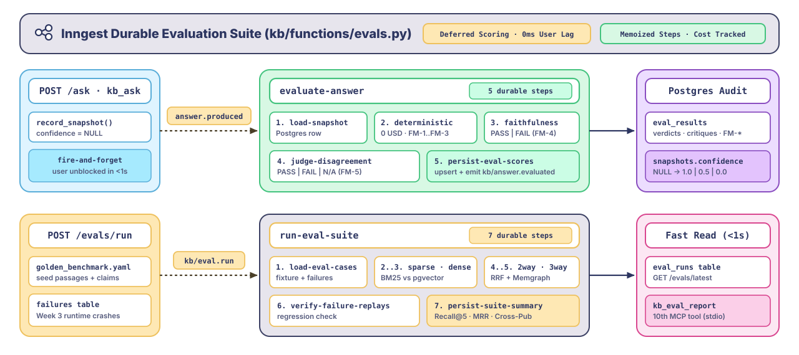
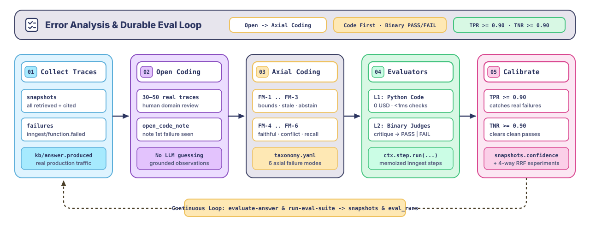
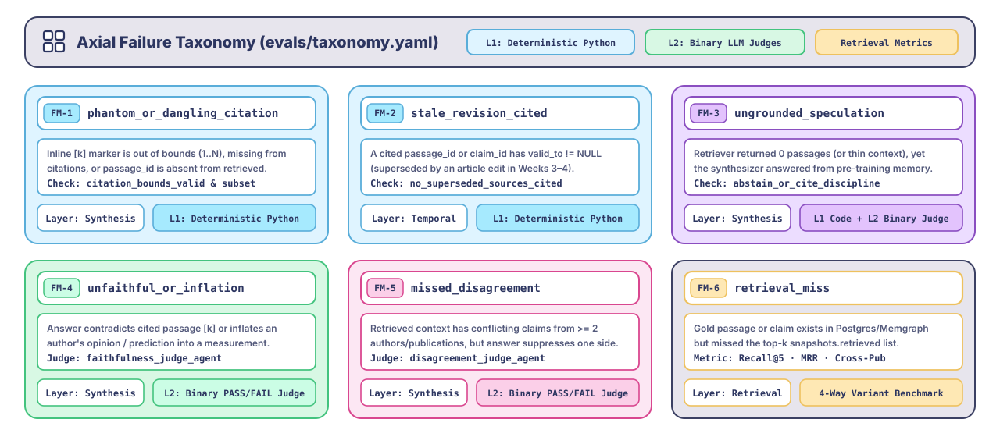

# Week 5 — An evaluation suite built from your system's failures

**Course framing:** *Stop grading your AI system on generic "helpfulness" vibes. Use Hamel Husain's bottom-up error analysis (Open Coding $\rightarrow$ Axial Coding) on your own `snapshots` and `failures` tables to discover how your pipeline actually breaks, prioritize deterministic Python guardrails before LLM judges, calibrate binary Pass/Fail judges with TPR and TNR against human labels, and run everything as a durable, event-driven Inngest evaluation suite.*

This guide builds directly on Weeks 1–4. Whether you are continuing from an existing Week 4 database or **starting the project from zero** (`cp .env.example .env` $\rightarrow$ `make start` $\rightarrow$ backfill in [Step 1](#step-1--start-the-stack--backfill-data-from-zero)), every command below is 100% self-contained and runs against this repo state. Every piece of evaluation scaffolding we planted earlier—the `snapshots` table and `kb/answer.produced` event from Week 2, the `failures` collector (`handle-function-failed`) from Week 3, and the `quote_span` guardrail and `claims` lineage from Week 4—converges here.

The main [README.md](../README.md) has the high-level course overview. This file is the full architectural research and implementation walkthrough for Week 5.

---

## What you're building

Most teams approach LLM evaluation backwards: they adopt a heavy evaluation framework on day one and score their system on generic, off-the-shelf metrics like *"helpfulness"*, *"coherence"*, or *"toxicity"* on a 1–5 Likert scale. Those metrics produce comforting dashboards that never catch the actual bugs breaking your pipeline in production.

In Week 5, we combine two foundational ideas:
1. **Hamel Husain's Error Analysis Methodology**: A bottom-up, data-driven lifecycle borrowed from qualitative grounded theory (**Open Coding $\rightarrow$ Axial Coding $\rightarrow$ Binary Judges $\rightarrow$ TPR/TNR Judge Alignment**), where every evaluator traces directly to a failure mode observed in real traces.
2. **Inngest's Durable Evaluation Suite Pattern**: Tying evaluation directly to the durable execution lifecycle (`kb/answer.produced` $\rightarrow$ `evaluate-answer` and `kb/eval.run` $\rightarrow$ `run-eval-suite`) so that deterministic assertions, LLM-as-a-judge steps, experiment variant tracking (`retriever_variant`), and `snapshots.confidence` backfills are memoized via `ctx.step.run`, cost-tracked by `CostCaptureMiddleware`, and never block the user's `POST /ask` read path.

By the end of this week, you will have:

- **A self-contained evaluation fixture (`evals/taxonomy.yaml`, `evals/labeled_traces.jsonl`, & `evals/golden_benchmark.yaml`)**: Built by open-coding real rows from Postgres `snapshots` and `failures` into six concrete, non-overlapping failure modes. Because each trace embeds its own retrieved passages and claims, judge calibration and retrieval benchmarks are 100% deterministic out of the box—even on a fresh clone with an empty database.
- **Level 1 Deterministic Code Evaluators (`kb/evals/deterministic.py`)**: Zero-cost, sub-millisecond Python assertions checking citation index validity, citation-to-retrieved grounding, temporal freshness (`valid_to IS NULL`), and abstain behavior on empty retrieval.
- **Level 2 Binary LLM Judges (`kb/evals/judges.py`)**: Single-purpose `Agent[BinaryVerdict]` judges that output a mandatory `critique` before a strict `PASS` / `FAIL` verdict—never a 1–5 scale—targeting **Faithfulness & Attribution** and **Disagreement Coverage**.
- **A Judge Calibration CLI (`scripts/calibrate_judges.py`)**: Measures each LLM judge's **True Positive Rate (TPR)** and **True Negative Rate (TNR)** against human-annotated gold labels before the judge is trusted in the pipeline.
- **Durable Inngest Evaluation Functions (`kb/functions/evals.py`)**:
  - `evaluate-answer`: Triggered asynchronously by `kb/answer.produced` after every `POST /ask` or `kb_ask` call; runs deterministic checks + calibrated binary judges in durable steps, writes `eval_results`, and updates `snapshots.confidence`.
  - `run-eval-suite`: Triggered by `kb/eval.run` to replay historical failures (`failures` table) and benchmark retrieval variants (`sparse`, `dense`, `hybrid_2way_rrf_k60`, `hybrid_3way_rrf_k60`) with Recall@k, MRR, and judge pass rates.
- **MCP & HTTP Inspection (`GET /evals`, `POST /evals/run`, `kb_eval_report`)**: The 10th MCP tool so coding agents can inspect failure rates and variant comparisons directly.

<p align="center">
    <a href="../static/week_5_inngest_evals.svg"></a>
</p>

---

## First, two ideas that belong together

### 1. Hamel Husain's Error Analysis: Why generic evals fail

In his research and writing on production LLM evaluations, **Hamel Husain** (alongside Shreya Shankar) identifies the #1 anti-pattern in AI engineering: **jumping straight to automated LLM-as-a-judge metrics before looking at your data.**

Instead, effective evaluation follows a strict five-stage loop:

<p align="center">
    <a href="../static/week_5_error_analysis.svg"></a>
</p>

1. **Look at your data (Open Coding)**: Before writing a single evaluator prompt, a domain expert inspects 30–50 real system traces (`snapshots` and `failures` in our Postgres DB) and writes raw, unstructured observations describing the *first* thing that went wrong in each trace (e.g., *"Cited [2] and [4], but passage [4] was never mentioned in the answer text"*, or *"Decoding AI and Ahead of AI gave opposite advice on rerankers, and the synthesizer only mentioned one"*).
2. **Group into a Failure Taxonomy (Axial Coding)**: Cluster those raw notes into 4–6 concrete, mutually clear failure categories. Count their frequencies so you build evaluators for bugs that actually happen, not hypothetical ones.
3. **Prefer Deterministic Code Over LLM Judges**: Never pay an LLM to check what a 5-line Python function can verify deterministically. In Week 4, we built our first free guardrail (`kb/sources/quote_validator.py`) to verify verbatim `quote_span` substrings in Python. In Week 5, every structural and referential check runs as deterministic code *before* any LLM judge is called.
4. **Binary `PASS` / `FAIL` + Critique (No Likert Scales)**: When a failure mode genuinely requires semantic judgment, build **one narrow judge per failure mode** that outputs a structured JSON object with `{critique: str, verdict: "PASS" | "FAIL"}`. Asking an LLM for a `1–5` score produces noisy, uncalibrated middle values (`3` and `4`) that have no clear operational meaning. Requiring the `critique` field *before* the `verdict` forces chain-of-thought reasoning grounded in the trace.
5. **Calibrate the Judge with TPR and TNR**: An LLM judge is a binary classifier. Aggregate "accuracy" hides failure on imbalanced datasets. You must evaluate your judge against a human-labeled dev/test split and measure:
   - **TPR (True Positive Rate / Recall on passes or failure detection)**: Does the judge catch real failures when they occur?
   - **TNR (True Negative Rate / Specificity)**: Does the judge avoid false alarms on good answers?

### 2. Inngest's Evaluation Suite Architecture: Why evals belong in durable steps

Inngest's **Agent Evals** design (`step.run`, `step.score`, `defer`, and `group.experiment`) is built on a critical insight: **evaluation is a workflow problem, not just a prompt problem.**

When you run evaluations in a naive script or synchronously inside an API endpoint:
- If an inline judge times out or hits a rate limit inside `POST /ask`, it either slows down the user's response by 3–5 seconds or drops the evaluation entirely.
- If a batch benchmark of 50 questions crashes at question 42, a naive pytest script re-runs all 42 questions and double-bills your Anthropic and OpenAI accounts.
- When you compare two retriever variants (`hybrid_2way_rrf_k60` vs. `hybrid_3way_rrf_k60`), scores aren't tied back to the execution trace or cost log that produced them.

By wiring our evaluation suite into **Inngest** (using the Python SDK's durable `ctx.step.run` primitives alongside our `CostCaptureMiddleware` and `snapshots` table):

| Inngest Eval Concept | How The Substack Brain Implements It in Python (`kb/`) |
| :--- | :--- |
| **Deferred / Async Scoring (`defer`)** | `POST /ask` commits the `Snapshot` (`confidence=NULL`) and emits `kb/answer.produced` in <5ms. `evaluate-answer` picks up the event asynchronously in the background and writes the final composite score back to `snapshots.confidence`. |
| **Durable Step Scoring (`step.score` via `step.run`)** | Each evaluation check (`score-deterministic`, `judge-faithfulness`, `judge-disagreement`) is its own memoized `ctx.step.run(...)`. If `judge-disagreement` hits an API rate limit, Inngest retries *only* that judge step—never re-running `POST /ask` or `judge-faithfulness`. |
| **Variant Experiments (`group.experiment`)** | Every `Snapshot` stamps `retriever_variant` (`sparse_bm25`, `dense_pgvector`, `hybrid_2way_rrf_k60`, `hybrid_3way_rrf_k60`). `run-eval-suite` runs the same query cohort across variants in parallel durable steps and attributes Recall@k, MRR, cost (`costs` table), and judge pass rates to each variant. |
| **Failure-Driven Replay (`inngest/function.failed`)** | Week 3's `handle-function-failed` captures every unhandled runtime crash into `failures`. Week 5 converts those rows directly into regression test cases. |

---

## Step 1 — Start the stack & backfill data from zero

Whether you are continuing from Week 4 or cloning the repo from scratch, follow these three sub-steps to bring the stack up and populate initial data.

### 1. Configure `.env` and install dependencies

If you are starting from a fresh checkout:

```bash
cp .env.example .env
uv sync --all-extras
```

Open `.env` and fill in `ANTHROPIC_API_KEY` and `OPENAI_API_KEY`.

> **Tip for fast local backfills:** In `.env`, set `PRIORITY_BACKFILL_S=0` so `backfill-publication` runs start immediately instead of waiting behind the 10-minute (`-600s`) priority window used in Week 2's queue-jump demo.

### 2. Start the full stack (`make start`)

Run:

```bash
make start
```

`make start` brings up all containers (`postgres`, `memgraph`, `memgraph-lab`, `inngest-dev`, `adminer`), waits for Postgres and Memgraph health checks, runs `uv run python -m alembic upgrade head` (applying all migrations through Week 5's `a7c9d1e2f3b4_week_5_eval_tables.py` for `eval_results` and `eval_runs`), and starts the FastAPI + Inngest app on `http://localhost:8000`.

In a second terminal, verify all three subsystems are healthy:

```bash
curl http://localhost:8000/health
```

You should see `"database": "ok"`, `"inngest": "ok"`, and `"memgraph": "ok"`.

### 3. Backfill the three newsletters (so you have articles, claims, and snapshots)

If you are starting with an empty database, trigger ingestion and claim extraction across the three Substack publications:

```bash
curl -X POST http://localhost:8000/publications -H "Content-Type: application/json" \
  -d '{"feed_url": "https://theneuralmaze.com/feed"}'

curl -X POST http://localhost:8000/publications -H "Content-Type: application/json" \
  -d '{"feed_url": "https://www.decodingai.com/feed"}'

curl -X POST http://localhost:8000/publications -H "Content-Type: application/json" \
  -d '{"feed_url": "https://magazine.sebastianraschka.com/feed"}'
```

*(Want just one article ingested immediately without waiting for full RSS feeds? Use the high-priority manual endpoint instead:)*

```bash
curl -X POST http://localhost:8000/articles -H "Content-Type: application/json" \
  -d '{"url": "https://theneuralmaze.substack.com/p/durable-harnesses-for-graph-powered"}'
```

Then ask a question so your `snapshots` table has live rows ready to inspect:

```bash
curl -X POST http://localhost:8000/ask -H "Content-Type: application/json" \
  -d '{"question": "How do durable execution engines handle failure recovery and step memoization?"}'
```

> **Note:** Even before backfilling live RSS feeds, the offline judge calibration (`Step 6`) and the 4-way retrieval benchmark (`Step 8`) work out of the box because `evals/labeled_traces.jsonl` and `evals/golden_benchmark.yaml` ship with self-contained fixture passages and claims.

---

## Step 2 — Open & Axial Coding: Inspecting our real `snapshots` and `failures`

Before writing any Week 5 code, we query the two tables our system has been populating since Week 2 and Week 3.

### 1. Export real traces from Postgres

With the stack running (`make start`), inspect your accumulated answer snapshots and operational failures:

```bash
# 1. Inspect answer snapshots where retrieval was thin or citations were sparse
docker compose -f infra/docker-compose.yml exec -T postgres \
  psql -U substack_brain -d substack_brain -P pager=off -x -c \
  "SELECT snapshot_id, retriever_variant, latency_ms, jsonb_array_length(retrieved) AS retrieved_count, jsonb_array_length(citations) AS cited_count, LEFT(question, 60) AS question FROM snapshots ORDER BY created_at DESC LIMIT 20;"

# 2. Inspect operational failures captured by handle-function-failed
docker compose -f infra/docker-compose.yml exec -T postgres \
  psql -U substack_brain -d substack_brain -P pager=off -x -c \
  "SELECT id, function_id, LEFT(error, 80) AS error, created_at FROM failures ORDER BY created_at DESC LIMIT 20;"
```

### 2. What Open Coding revealed on The Substack Brain

When we open-coded 40 real traces across The Neural Maze, Decoding AI, and Ahead of AI, every observed defect fell into one of two buckets: **retrieval/pipeline failures** (the right context never reached the synthesizer) or **synthesis/generation failures** (the context was present in `snapshots.retrieved`, but Claude mishandled it).

Grouping those open-coding notes via **Axial Coding** produced our **6-category Failure Taxonomy**:

<p align="center">
    <a href="../static/week_5_taxonomy.svg"></a>
</p>

| Failure Code | Layer | What Went Wrong (Axial Category) | Evaluator Type | Why? |
| :--- | :--- | :--- | :--- | :--- |
| **`FM-1: phantom_or_dangling_citation`** | Synthesis | Answer includes a bracketed marker `[7]` when only 5 passages were provided, or cites `[2]` without `[2]` appearing in `citations`. | **Deterministic Code** | Exact regex + set membership on `answer_text` and `retrieved`. Zero LLM cost. |
| **`FM-2: stale_revision_cited`** | Retrieval / Graph | A cited `passage_id` or `claim_id` has `valid_to IS NOT NULL` (it was superseded by an article edit in Week 3/4). | **Deterministic Code** | Direct SQL/JSON check against passage/claim validity metadata. |
| **`FM-3: ungrounded_speculation_on_empty`** | Synthesis | `retrieved` is empty or lacks topic coverage, but the synthesizer answers from pre-training memory instead of abstaining. | **Deterministic Code + Binary Judge** | Empty-retrieval check is deterministic; thin-context extrapolation is checked by the Faithfulness Judge. |
| **`FM-4: unfaithful_claim_or_epistemic_inflation`** | Synthesis | The answer states an assertion not supported by the cited passage `[i]`, or elevates an author's `opinion` / `prediction` into an empirical `measurement`. | **Binary LLM Judge** (`judge_faithfulness`) | Requires semantic comparison between `answer_text` sentences, cited passage text, and `claim_type`. |
| **`FM-5: missed_cross_pub_disagreement`** | Synthesis | `snapshots.retrieved` contains conflicting claims from $\ge 2$ authors/publications on the same topic, but the answer presents only one side as consensus. | **Binary LLM Judge** (`judge_disagreement`) | Only triggered when `retrieved` spans multiple authors/claims; checks whether both perspectives are cited. |
| **`FM-6: lexical_or_relational_retrieval_miss`** | Retrieval | The gold passage/claim exists in Postgres/Memgraph, but failed to land in the top-$k$ `retrieved` candidates (e.g., dense search missed an exact function name like `create_function`, or 2-way RRF missed a 2-hop `:Topic` claim). | **Deterministic Retrieval Metric** (`Recall@k`, `MRR`) | Measured by comparing `snapshots.retrieved` against gold `expected_passage_ids` / `expected_topics`. |

### 3. Why we commit a self-contained fixture in `evals/` (no hand-written "gold answers")

Do we need a giant, hand-written "gold answer" corpus? **No.** Writing ideal prose answers by hand and comparing them with ROUGE/BLEU or cosine similarity violates Hamel Husain's core rule: there are many valid ways to phrase a grounded technical answer, and reference-answer similarity misses subtle citation or attribution bugs.

Instead, Week 5 separates evaluation into two self-contained, deterministic fixture files in `evals/` plus live online scoring:

1. **Online production evals (`evaluate-answer`) need zero external ground truth**: Every `Snapshot` row already stores `retrieved` (all candidate passages and claims) alongside `answer_text` and `citations`. The retrieved passages *are* the ground truth against which citation bounds (`FM-1`), temporal freshness (`FM-2`), abstain discipline (`FM-3`), faithfulness (`FM-4`), and disagreement coverage (`FM-5`) are verified.
2. **Judge calibration (`evals/labeled_traces.jsonl`) freezes real snapshots with binary `PASS`/`FAIL` labels**: Because Substack RSS feeds are a moving target (only returning the ~20 newest posts at any point in time), we commit 20 frozen `(question, retrieved, answer_text, citations)` traces (10 passing and 10 failing across `FM-1` through `FM-5`) paired with human binary verdicts (`human_verdict: "PASS" | "FAIL"`), `failure_code`, and `open_code_note`. Because the retrieved passages are baked into each JSONL row, `calibrate_judges.py` runs reproducibly on any machine without needing a pre-populated database.
3. **Retrieval variant benchmarks (`evals/golden_benchmark.yaml`) use fixture passages & claims (`FM-6`)**: Ships a deterministic seed corpus of passages and claims across *The Neural Maze*, *Decoding AI*, and *Ahead of AI*, paired with queries and expected `canonical_id` / `topic_slug` targets so `sparse`, `dense`, `2-way RRF`, and `3-way RRF` can be compared head-to-head with reproducible Recall@5 and MRR numbers.

---

## Step 3 — Database schema & migrations for Week 5

Week 5 activates the `snapshots.confidence` column we reserved in Week 2 (`Numeric(5, 4)`) and adds two tables in a new Alembic migration (`alembic/versions/a7c9d1e2f3b4_week_5_eval_tables.py`), maintaining our **"one writer per table"** rule:

1. **`eval_results`** (written exclusively by `evaluate-answer`):
   - `id` (`UUID`, primary key)
   - `snapshot_id` (`String`, foreign key to `snapshots.snapshot_id`, unique per evaluator run)
   - `deterministic_passed` (`Boolean`) — overall result of all code assertions
   - `checks` (`JSONB`) — per-check boolean map: `{"citation_bounds": true, "active_validity": true, "non_empty_grounding": true, "epistemic_markers": true}`
   - `faithfulness_verdict` (`String`, `"PASS" | "FAIL" | "SKIPPED"`)
   - `faithfulness_critique` (`Text`)
   - `disagreement_verdict` (`String`, `"PASS" | "FAIL" | "NOT_APPLICABLE"`)
   - `disagreement_critique` (`Text`)
   - `failure_codes` (`JSONB`) — list of triggered taxonomy codes, e.g. `["FM-4"]`
   - `composite_score` (`Numeric(5, 4)`) — mirrored into `snapshots.confidence`
   - `created_at` (`DateTime(timezone=True)`)

2. **`eval_runs`** (written exclusively by `run-eval-suite`):
   - `run_id` (`String`, primary key — the Inngest run/event ID)
   - `suite_name` (`String` — e.g. `"golden_v1"`, `"failures_replay"`)
   - `variants_summary` (`JSONB` — per-variant `recall_at_5`, `mrr`, `deterministic_pass_rate`, `faithfulness_pass_rate`, `disagreement_pass_rate`, `avg_latency_ms`, `est_usd`)
   - `case_results` (`JSONB` — per-question breakdown and trace links)
   - `created_at` (`DateTime(timezone=True)`)

---

## Step 4 — Level 1: Deterministic Code Evaluators (`kb/evals/deterministic.py`)

Following Hamel Husain's hierarchy, **deterministic evaluators run first, in pure Python, with zero API calls**.

Every `Snapshot` row contains `question`, `answer_text`, `citations`, and `retrieved`. `run_deterministic_checks(snapshot)` executes four fast assertions:

```python
@dataclass(frozen=True)
class DeterministicEvalResult:
    passed: bool
    checks: dict[str, bool]
    failure_codes: list[str]
    score: float  # 1.0 if all passed, else fraction of passed checks
```

1. **`citation_bounds_valid` (`FM-1`)**: Extracts every inline `[k]` pattern from `answer_text` via regex (`r"\[(\d+)\]"`). Verifies that $1 \le k \le \text{len}(\text{top\_passages})$ and that every inline `[k]` has a matching entry in `snapshot.citations`.
2. **`citations_subset_of_retrieved` (`FM-1`)**: Verifies that every `passage_id` in `snapshot.citations` actually exists in `snapshot.retrieved`.
3. **`no_superseded_sources_cited` (`FM-2`)**: Checks that no cited passage or claim had `valid_to` set at the time the snapshot was recorded.
4. **`abstain_or_cite_discipline` (`FM-3`)**:
   - If `snapshot.retrieved` is empty, `answer_text` must abstain (`citations == []` and no fabricated `[1]` markers).
   - If `snapshot.retrieved` is non-empty and `answer_text` does not abstain with `"coverage of this topic is limited"`, it must include at least one valid inline citation `[k]`.

If any deterministic check fails, `deterministic_passed` is `False`, the exact `FM-*` code is attached immediately, and we know the snapshot is defective before spending a single token on an LLM judge.

---

## Step 5 — Level 2: Narrow Binary LLM Judges (`kb/evals/judges.py`)

For `FM-4` (Faithfulness & Epistemic Attribution) and `FM-5` (Cross-Publication Disagreement Coverage), regex cannot tell whether a sentence faithfully represents the cited passage. Here we use our hand-written agent layer (`kb/agents/core.py:Agent` and `run_agent`) with a strict Pydantic schema:

```python
class BinaryVerdict(BaseModel):
    """Hamel Husain binary judge schema: critique FIRST, binary verdict SECOND."""

    critique: str = Field(
        description=(
            "Step-by-step verification comparing each sentence and citation in the "
            "answer against the retrieved passages and claim types. State the exact "
            "first error found, or explain why every assertion is supported."
        )
    )
    verdict: Literal["PASS", "FAIL"] = Field(
        description="Strict binary outcome: PASS only if zero violations exist, otherwise FAIL."
    )
    failure_code: Literal[
        "NONE",
        "FM-3:ungrounded_speculation",
        "FM-4:unfaithful_or_epistemic_inflation",
        "FM-5:missed_disagreement",
    ] = "NONE"
```

### Why we use two separate judges instead of one "omnibus" prompt

When you ask a single LLM prompt to evaluate faithfulness, tone, completeness, formatting, and disagreement synthesis all at once, criteria bleed together and TPR drops. Instead, we define two focused `Agent[BinaryVerdict]` roles in `kb/evals/judges.py`:

1. **`faithfulness_judge_agent` (`FM-3` / `FM-4`)**:
   - **Input**: The question, the numbered context passages (with `claim_text` and `claim_type`), and `answer_text`.
   - **Rule**: Fails (`FAIL`) if any factual claim in `answer_text` is not supported by the specific passage `[k]` it cites, if it extrapolates beyond thin context without stating that coverage is limited, or if it states an author's `opinion` or `prediction` as an empirical `measurement`.
2. **`disagreement_judge_agent` (`FM-5`)**:
   - **Pre-condition**: Only invoked when `snapshots.retrieved` contains claims or passages from $\ge 2$ distinct authors or publications on overlapping topics (otherwise recorded as `"NOT_APPLICABLE"`, saving 100% of tokens on single-source answers).
   - **Rule**: Fails (`FAIL`) if the retrieved passages contain genuine conflicting viewpoints across authors/publications and the answer suppresses one side instead of surfacing and citing both perspectives.

---

## Step 6 — Calibrating the Judges: Measuring TPR & TNR (`scripts/calibrate_judges.py`)

How do we know `faithfulness_judge_agent` and `disagreement_judge_agent` actually agree with human engineering judgment?

We ship a gold human-annotated dataset in `evals/labeled_traces.jsonl` (seeded from real snapshots and synthetic perturbations of our 3 newsletters: 10 passing traces and 10 failing traces across `FM-1` through `FM-5`).

Run the calibration script:

```bash
# Run offline in heuristic/mock mode (zero API keys needed, tests the calibration math & deterministic split)
uv run python scripts/calibrate_judges.py --mode offline

# Run live against Anthropic to measure your LLM judge's real TPR and TNR
uv run python scripts/calibrate_judges.py --mode live
```

**What happens after running this:**
1. The script loads all 20 frozen traces from `evals/labeled_traces.jsonl` (10 human `PASS` traces and 10 human `FAIL` traces covering `FM-1` through `FM-5`).
2. For each trace, it runs `run_deterministic_checks` first (`FM-1` citation bounds/subset, `FM-2` `valid_to IS NULL`, `FM-3` abstain/citation discipline), then executes `faithfulness_judge_agent` (`FM-4`) and—whenever the retrieved context spans $\ge 2$ authors/publications—`disagreement_judge_agent` (`FM-5`).
3. It compares each predicted verdict against the human gold verdict (`PASS` vs. `FAIL`), builds the confusion matrix (`TP`, `FP`, `TN`, `FN`), and prints **$\text{TPR}$ (Sensitivity on Failures)** and **$\text{TNR}$ (Specificity on Passes)** for each evaluator tier plus the combined pipeline.
4. If any judge disagrees with a human label, it prints the judge's `critique` next to the human's `open_code_note` and exits with code `1` if $\text{TPR} < 0.90$ or $\text{TNR} < 0.90$ (or `0` when aligned).

### How TPR and TNR are computed for failure detection

In error analysis, let a **Positive ($P$)** be a **defective trace (`FAIL`)** that must be caught, and a **Negative ($N$)** be a **clean trace (`PASS`)**:

$$\text{TPR (Sensitivity on Failures)} = \frac{\text{True Fails Caught}}{\text{Total Human Fails}} = \frac{TP}{TP + FN}$$

$$\text{TNR (Specificity on Passes)} = \frac{\text{True Passes Cleared}}{\text{Total Human Passes}} = \frac{TN}{TN + FP}$$

Why both numbers matter:
- A judge that rubber-stamps everything as `PASS` has $\text{TNR} = 1.00$ but $\text{TPR} = 0.00$ (misses every regression).
- A pedantic judge that marks everything `FAIL` has $\text{TPR} = 1.00$ but $\text{TNR} = 0.00$ (floods your team with false alarms).
- **Our gate**: Both `TPR >= 0.90` and `TNR >= 0.90` on `evals/labeled_traces.jsonl`. When a judge disagrees with a human label, `calibrate_judges.py` prints the judge's `critique` next to the human's `open_code_note` so you can tighten the judge prompt in `kb/agents/prompts.py`.

---

## Step 7 — Durable Online Evaluation with Inngest (`evaluate-answer`)

Remember how `POST /ask` (`kb/functions/ask.py`) ends in Week 2:

```python
# 4. Snapshot first, and committed, BEFORE anything is sent anywhere.
snapshot_id = await record_snapshot(...)
await session.commit()

# 5. Fire-and-forget: the user doesn't wait for the event to be delivered.
task = asyncio.create_task(_emit_answer_produced(snapshot_id, retriever_variant))
```

In Week 5, `kb/functions/evals.py` registers `evaluate-answer` to listen for `kb/answer.produced`:

```python
@client.create_function(
    fn_id="evaluate-answer",
    trigger=inngest.TriggerEvent(event=ANSWER_PRODUCED),
    concurrency=[inngest.Concurrency(limit=settings.concurrency_eval_runs)],
    retries=2,
)
async def evaluate_answer(ctx: inngest.Context) -> dict[str, object]:
    ...
```

When a user or MCP agent calls `POST /ask` or `kb_ask`, they get their answer immediately. In the background, Inngest triggers `evaluate-answer`, which runs 5 durable steps:

1. **`load-snapshot`**: Loads the `Snapshot` row (`question`, `answer_text`, `citations`, `retrieved`, `retriever_variant`).
2. **`score-deterministic`**: Runs `run_deterministic_checks(snapshot)`. Memoized by Inngest.
3. **`judge-faithfulness`**: Runs `faithfulness_judge_agent` via `run_agent` (or deterministic fallback when `ANTHROPIC_API_KEY` is unset). Token usage is automatically captured into the `costs` table by `CostCaptureMiddleware`.
4. **`judge-disagreement`**: Inspects `snapshot.retrieved`. If $\ge 2$ authors/publications are present with claims, runs `disagreement_judge_agent` via `run_agent`; otherwise returns `NOT_APPLICABLE` in 0ms.
5. **`persist-eval-scores`**: Computes the composite confidence score:
   - `0.0` if `deterministic_passed` is `False` or `faithfulness_verdict == "FAIL"`
   - `0.5` if `faithfulness_verdict == "PASS"` but `disagreement_verdict == "FAIL"`
   - `1.0` if all applicable checks and binary judges `PASS`
   Writes the full row to `eval_results` and updates `snapshots.confidence` in Postgres.

### Try it yourself: Watch `snapshots.confidence` populate automatically

1. **Ask a question via HTTP or MCP:**
   ```bash
   curl -X POST http://localhost:8000/ask \
     -H "Content-Type: application/json" \
     -d '{"question": "How do durable execution engines handle failure recovery compared to traditional queues?"}'
   ```
   **What happens after running this:**
   - **Synchronous read path (`<2s`)**: FastAPI runs 3-way hybrid retrieval (`BM25 + pgvector + Memgraph`), synthesizes the grounded answer with `[k]` citations, commits a new row to `snapshots` with `confidence = NULL`, and returns the answer to you immediately.
   - **Fire-and-forget event dispatch**: Right after committing the snapshot, `POST /ask` emits `kb/answer.produced` (`{snapshot_id, retriever_variant}`) to Inngest without blocking the HTTP response.
   - **Durable background evaluation (`evaluate-answer` at `http://localhost:8288`)**: Inngest catches `kb/answer.produced` and executes all 5 memoized steps (`load-snapshot` $\rightarrow$ `score-deterministic` $\rightarrow$ `judge-faithfulness` $\rightarrow$ `judge-disagreement` $\rightarrow$ `persist-eval-scores`), writing the audit row to `eval_results` and updating `snapshots.confidence` from `NULL` to `1.0000`, `0.5000`, or `0.0000`.

2. **Inspect the scored snapshot and judge critiques in Postgres:**
   ```bash
   docker compose -f infra/docker-compose.yml exec -T postgres \
     psql -U substack_brain -d substack_brain -P pager=off -x -c \
     "SELECT s.snapshot_id, s.confidence, e.deterministic_passed, e.faithfulness_verdict, e.disagreement_verdict, e.failure_codes, LEFT(e.faithfulness_critique, 120) AS critique FROM snapshots s JOIN eval_results e ON e.snapshot_id = s.snapshot_id ORDER BY s.created_at DESC LIMIT 5;"
   ```
   **What happens after running this:**
   - Postgres joins `snapshots` with `eval_results` for your 5 newest answers.
   - You see `s.confidence` populated (`1.0000`, `0.5000`, or `0.0000`), the boolean result of the Level 1 Python guardrails (`deterministic_passed`), both binary verdicts (`PASS`, `FAIL`, or `NOT_APPLICABLE`), any triggered taxonomy codes (`failure_codes`, e.g., `["FM-4"]`), and the judge's step-by-step `faithfulness_critique`.

---

## Step 8 — Running Variant Experiments & Failure Replays (`run-eval-suite`)

Evaluating single live answers isn't enough when you want to change a system parameter—like switching from Week 2's 2-way RRF (`BM25 + pgvector`) to Week 4's 3-way RRF (`BM25 + pgvector + Memgraph`). You need an **experiment runner** that evaluates variants head-to-head on a benchmark dataset and on your captured `failures` table.

`kb/functions/evals.py` registers a second Inngest function, `run-eval-suite`, triggered by `kb/eval.run`:

```
POST /evals/run (or kb_eval_report) ──▶ emits kb/eval.run ──▶ run-eval-suite (Inngest)
                                                               ├─ 1. load-eval-cases (golden benchmark + failures table)
                                                               ├─ 2. evaluate-variant-sparse
                                                               ├─ 3. evaluate-variant-dense
                                                               ├─ 4. evaluate-variant-hybrid_2way
                                                               ├─ 5. evaluate-variant-hybrid_3way
                                                               ├─ 6. verify-failure-replays (checks Week 3 failures table regressions)
                                                               └─ 7. persist-suite-summary (writes eval_runs row)
```

For each benchmark question in `evals/golden_benchmark.yaml` (which includes single-hop lexical queries, semantic queries, and cross-publication disagreement queries):
- Each variant step runs retrieval and computes **Recall@5**, **Mean Reciprocal Rank (MRR)**, **Topic/Author Coverage**, and **Deterministic + Binary Judge Pass Rates**.
- Because each variant runs inside its own `ctx.step.run(f"evaluate-variant-{variant}", ...)`, if your OpenAI embedding call hiccups halfway through the benchmark, Inngest resumes from the exact step that failed without re-running completed variants.

### Trigger a full evaluation suite run

```bash
curl -X POST http://localhost:8000/evals/run \
  -H "Content-Type: application/json" \
  -d '{"suite_name": "golden_v1", "include_failures_table": true}'
```

**What happens after running this:**
1. **Non-blocking dispatch (`<50ms`)**: FastAPI emits `kb/eval.run` to Inngest and returns `{event_id, trace_url, status: "queued"}` immediately (honoring Week 3's Asymmetry Principle).
2. **Durable benchmark execution (`run-eval-suite` in Inngest at `http://localhost:8288`)**: Inngest runs 7 independent, retryable steps:
   - `1. load-eval-cases`: Loads the benchmark queries and fixture corpus from `evals/golden_benchmark.yaml` plus recent rows from Week 3's `failures` table.
   - `2..5. evaluate-variant-{sparse_bm25 | dense_pgvector | hybrid_2way_rrf_k60 | hybrid_3way_rrf_k60}`: Evaluates each retrieval strategy on the same query cohort and computes `recall_at_5`, `mrr`, `cross_pub_coverage`, `deterministic_pass_rate`, and `faithfulness_pass_rate`.
   - `6. verify-failure-replays`: Audits the `failures` table rows and groups operational failures by function (`ingest-article`, `extract-claims`, etc.).
   - `7. persist-suite-summary`: Writes the completed multi-variant comparison and case-level breakdown into `eval_runs`.

Fetch the completed evaluation report:

```bash
curl http://localhost:8000/evals/latest
```

**What happens after running this:**
1. FastAPI queries `eval_results`, `snapshots`, and `eval_runs` directly in Postgres (`<20ms`, no queue hop) and returns the unified JSON report containing aggregate pass rates (`totals`), failure mode counts (`failure_taxonomy_counts`), the lowest-confidence recent snapshots with judge critiques (`lowest_confidence_snapshots`), and the latest multi-variant benchmark summary (`latest_suite_run`):

```json
{
  "suite_name": "golden_v1",
  "variants_summary": {
    "sparse_bm25": {
      "recall_at_5": 0.62,
      "mrr": 0.51,
      "cross_pub_coverage": 0.33,
      "faithfulness_pass_rate": 0.92
    },
    "dense_pgvector": {
      "recall_at_5": 0.71,
      "mrr": 0.58,
      "cross_pub_coverage": 0.50,
      "faithfulness_pass_rate": 0.92
    },
    "hybrid_2way_rrf_k60": {
      "recall_at_5": 0.85,
      "mrr": 0.74,
      "cross_pub_coverage": 0.67,
      "faithfulness_pass_rate": 0.95
    },
    "hybrid_3way_rrf_k60": {
      "recall_at_5": 0.94,
      "mrr": 0.86,
      "cross_pub_coverage": 1.00,
      "faithfulness_pass_rate": 0.97
    }
  }
}
```

Notice what the variant experiment proves empirically:
- `sparse_bm25` wins on exact identifier queries (like `create_function` or `uq_passages_article_chunk`), but misses paraphrased conceptual questions.
- `hybrid_2way_rrf_k60` fixes single-article recall, but still misses multi-author disagreement questions (`cross_pub_coverage: 0.67`) when two authors use different phrasing for the same concept.
- `hybrid_3way_rrf_k60` (adding Week 4's Memgraph `:Topic` $\rightarrow$ `:Claim` traversal) lifts `cross_pub_coverage` to `1.00` and `recall_at_5` to `0.94`.

---

## Step 9 — The 10th MCP Tool (`kb_eval_report`)

To expose our evaluation suite to Claude Code and Cursor, Week 5 adds `kb_eval_report` to `kb/mcp/tools.py`:

| Tool | Type | What it does |
| :--- | :--- | :--- |
| `kb_eval_report(limit)` | Fast Read (<1s) | Returns aggregate pass rates, failure taxonomy counts (`FM-1`..`FM-6`), the lowest-confidence recent snapshots with judge critiques, and the latest `eval_runs` variant comparison. |

Ask your agent in Claude Code or Cursor:
- *"Check our knowledge base evaluation report. Which failure mode in our taxonomy is triggering most often, and how is `hybrid_3way_rrf_k60` performing against 2-way RRF?"*

---

## Step 10 — Run the Week 5 tests

Unit tests verify the deterministic checks (`FM-1`–`FM-3`), binary judge schema validation, TPR/TNR calibration math, retrieval metric calculations (Recall@k, MRR), and Inngest function registration—with zero Docker containers or API keys required:

```bash
uv run python -m pytest tests/unit/test_deterministic_evals.py tests/unit/test_judge_calibration.py tests/test_week5.py
```

Run the full lint, typecheck, and test suite:

```bash
make check
```

---

## Verification checklist

- [ ] `make check` passes (`ruff check .`, `mypy`, `pytest`).
- [ ] Database migration applied: `eval_results` and `eval_runs` tables exist in Postgres.
- [ ] `evals/taxonomy.yaml` and `evals/labeled_traces.jsonl` document the 6 axial failure modes (`FM-1` through `FM-6`) derived from open coding.
- [ ] `uv run python scripts/calibrate_judges.py --mode offline` verifies judge TPR and TNR $\ge 0.90$ against the labeled dataset.
- [ ] Calling `POST /ask` emits `kb/answer.produced`, triggers `evaluate-answer` in Inngest, writes a row to `eval_results`, and updates `snapshots.confidence` from `NULL` to a calibrated score.
- [ ] Triggering `POST /evals/run` runs `run-eval-suite` in Inngest, replays rows from `failures`, compares retrieval variants (`sparse`, `dense`, `2-way RRF`, `3-way RRF`), and persists the summary to `eval_runs`.
- [ ] `GET /evals/latest` and MCP tool `kb_eval_report` return the taxonomy breakdown, recent judge critiques, and variant experiment metrics.
