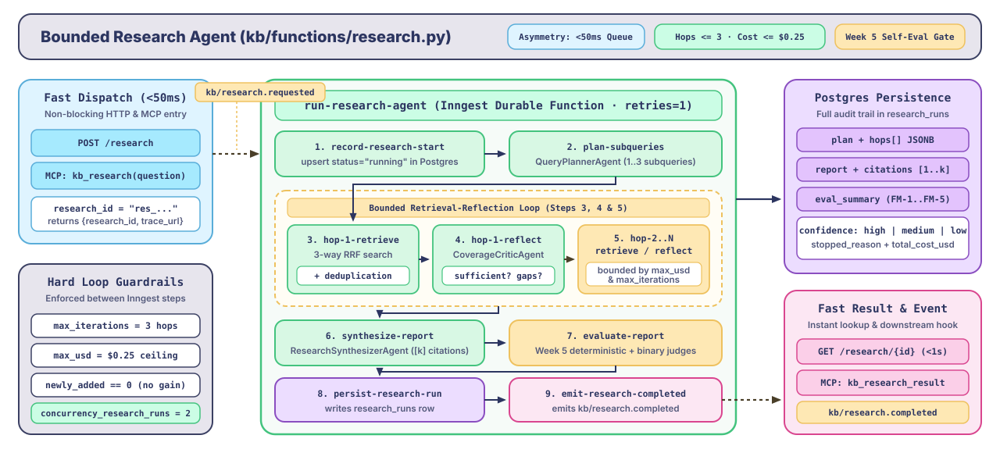
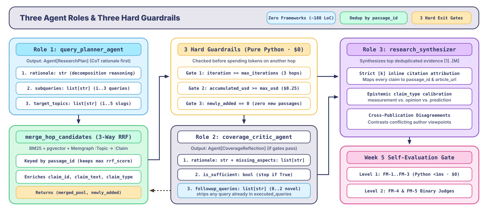
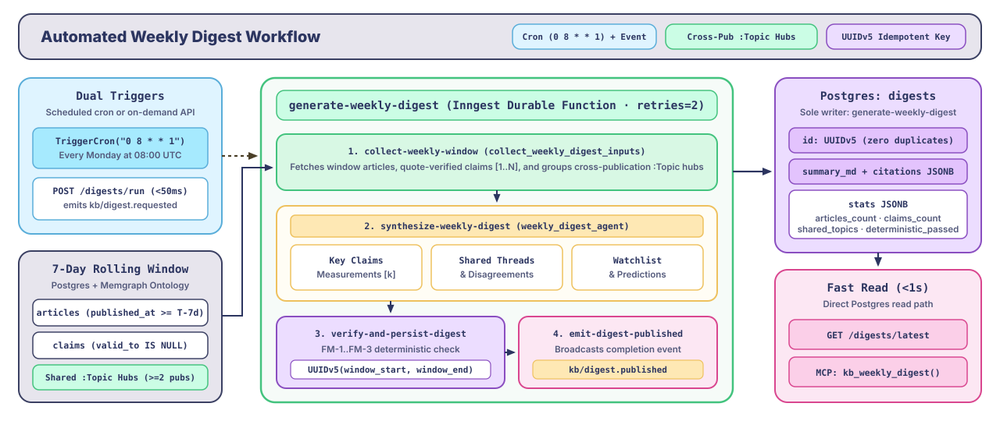
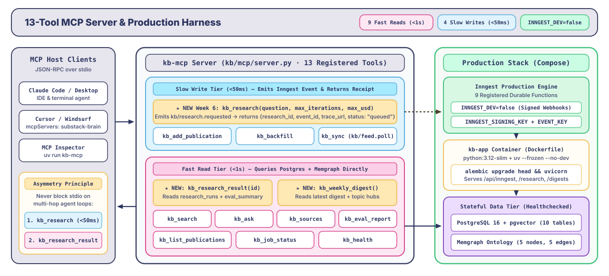

# Week 6 — A bounded research agent, a weekly digest, and a production deploy

**Course framing:** *Turn your knowledge base into an autonomous, budget-bounded research system: decompose multi-hop technical questions, iterate over 3-way hybrid retrieval with explicit iteration and USD cost caps, verify every research report with Week 5's deterministic and binary judges, publish an automated weekly newsletter digest on a cron schedule, and package the entire stack for production.*

This guide is the capstone of **The Substack Brain** (Weeks 1–6). Every architectural primitive built in Weeks 1–5—durable step execution (`ctx.step.run`), `CostCaptureMiddleware`, the Asymmetry Principle (`<50ms` writes vs. `<1s` reads), the 5-node Memgraph ontology + 3-way RRF (`hybrid_3way_rrf_k60`), and our calibrated evaluation suite (`FM-1`–`FM-6`)—converges here.

The main [README.md](../README.md) has the high-level course overview. This file is the full architectural and implementation walkthrough for Week 6.

---

## What you're building

Single-shot RAG (`POST /ask`) answers focused questions in under two seconds, but complex engineering investigations rarely fit into a single retrieval query:
- *"Compare how The Neural Maze, Decoding AI, and Ahead of AI evaluate agent orchestration vs. test-time compute, including concrete latency/cost measurements and where the authors disagree."*

At the same time, unconstrained "autonomous" agent loops fail in production for three predictable reasons:
1. **Runaway token and API loops**: Re-querying the same concepts endlessly until a rate limit or timeout kills the worker—losing all intermediate progress.
2. **Context window pollution**: Dumping duplicate chunks from multiple hops into the final prompt without deduplicating or preserving claim lineage.
3. **Unverified synthesis**: Returning a long multi-hop report without checking whether inline citations `[k]` are valid, active (`valid_to IS NULL`), and faithful to epistemic `claim_type` boundaries.

By the end of Week 6, you will have:

- **A Bounded Research Agent (`run-research-agent` in `kb/functions/research.py`)**:
  - Built directly on Inngest durable steps (`ctx.step.run`) and our hand-written agent layer (`kb/agents/core.py` & `kb/agents/roles/researcher.py`)—with zero agent frameworks.
  - Enforces **three hard termination guardrails**: `max_iterations` (default `3`), `max_usd` (default `$0.25` tracked across steps), and a **zero-new-passages convergence check** that stops immediately if a hop discovers no new unique `passage_id`s.
  - Evaluates its own synthesized report using Week 5's Level 1 deterministic checks (`FM-1`–`FM-3`) and Level 2 binary judges (`FM-4` faithfulness, `FM-5` cross-publication disagreement coverage) before persisting to `research_runs`.
- **An Automated Weekly Digest (`generate-weekly-digest` in `kb/functions/digest.py`)**:
  - Runs every Monday at 08:00 UTC (`0 8 * * 1`) or on-demand via `POST /digests/run` (`kb/digest.requested`).
  - Aggregates the week's ingested articles, quote-verified claims, and cross-publication `:Topic` hubs into a cited markdown briefing stored in `digests`.
- **HTTP & MCP Research Interfaces (`POST /research`, `GET /research/{id}`, `kb_research`, `kb_research_result`, `kb_weekly_digest`)**:
  - Honors Week 3's **Asymmetry Principle**: queuing a multi-hop research run takes `<50ms` and returns `{research_id, event_id, trace_url, status: "queued"}`; reading the completed report or weekly digest queries Postgres directly in `<1s`.
- **Production Deployment Packaging (`Dockerfile` & `infra/docker-compose.prod.yml`)**:
  - A locked, multi-stage `uv` container image and production Compose stack (`INNGEST_DEV=false`, signing/event keys, health checks) ready to deploy.

<p align="center">
    <a href="../static/week_6_research_agent.svg"></a>
</p>

```
POST /research (or kb_research) ──▶ emits kb/research.requested (<50ms)
                                          │
                                          ▼
                                run-research-agent (Inngest)
                                  ├─ 1. record-research-start (status="running")
                                  ├─ 2. plan-subqueries (QueryPlannerAgent)
                                  ├─ 3. hop-1-retrieve (3-way RRF + deduplication)
                                  ├─ 4. hop-1-reflect (CoverageCriticAgent: stop or follow-up)
                                  ├─ 5. hop-2-retrieve / hop-2-reflect (bounded by max_iterations & max_usd)
                                  ├─ 6. synthesize-report (ResearchSynthesizerAgent with [k] citations)
                                  ├─ 7. evaluate-report (Week 5 deterministic + binary judges)
                                  ├─ 8. persist-research-run (writes research_runs)
                                  └─ 9. emit-research-completed (kb/research.completed)

Cron (0 8 * * 1) / POST /digests/run ──▶ generate-weekly-digest ──▶ writes digests + emits kb/digest.published
```

---

## Step 1 — Start the stack & apply Week 6 migrations

Run:

```bash
make start
```

`make start` brings up Postgres, Memgraph, Memgraph Lab, Adminer, and the Inngest Dev Server, runs `uv run python -m alembic upgrade head` (applying `alembic/versions/b8d2e4f6a1c3_week_6_research_and_digest_tables.py` to create `research_runs` and `digests`), and starts FastAPI on `http://localhost:8000`.

Verify the new tables exist in Postgres:

```bash
docker compose -f infra/docker-compose.yml exec -T postgres \
  psql -U substack_brain -d substack_brain -c "\dt"
```

You will see `research_runs` and `digests` alongside `publications`, `articles`, `passages`, `claims`, `snapshots`, `failures`, `eval_results`, and `eval_runs`—each adhering strictly to our **one writer per table** invariant:
- `research_runs` is written exclusively by `run-research-agent`.
- `digests` is written exclusively by `generate-weekly-digest`.

---

## Step 2 — Inside the Bounded Research Agent (`kb/agents/roles/researcher.py` & `kb/functions/research.py`)

<p align="center">
    <a href="../static/week_6_roles_and_guardrails.svg"></a>
</p>

### 1. Three Focused Agent Roles (Zero Frameworks)

Instead of a monolithic prompt or an opaque graph framework, `kb/agents/roles/researcher.py` defines three single-purpose roles on top of `kb/agents/core.py:Agent`:

1. **`query_planner_agent` (`Agent[ResearchPlan]`)**:
   - Outputs `{rationale: str, subqueries: list[str], target_topics: list[str]}`.
   - Decomposes the user's question into `1..3` initial search queries spanning lexical identifiers, semantic concepts, and canonical graph topics.
2. **`coverage_critic_agent` (`Agent[CoverageReflection]`)**:
   - Outputs `{rationale: str, is_sufficient: bool, missing_aspects: list[str], followup_queries: list[str]}`.
   - Inspects the cumulative deduplicated evidence pool after each hop and decides whether to stop (`is_sufficient=True`) or issue `1..2` targeted follow-up queries that have not yet been executed.
3. **`research_synthesizer_agent`**:
   - Writes the final multi-section technical brief from the top deduplicated passages and claims, citing sources inline (`[1]`, `[2]`), respecting epistemic `claim_type` boundaries (`measurement`, `opinion`, `prediction`), and surfacing cross-publication disagreements.

### 2. Three Hard Stopping Guardrails

Every hop in `run-research-agent` (`kb/functions/research.py`) checks three deterministic bounds before spending tokens on another iteration:

1. **Iteration Cap (`max_iterations`, default `3`, max `5`)**: The loop never exceeds `max_iterations` retrieval hops.
2. **USD Budget Cap (`max_usd`, default `$0.25`)**: Every LLM call returns `"usage": {"est_usd": ...}` (and [`run_agent_with_usage`](../kb/agents/core.py) threads `est_usd` into [`bounded_loop`](../kb/agents/core.py)). If accumulated step cost reaches `max_usd`, the agent exits the loop immediately, synthesizes from the evidence gathered so far, and marks `stop_reason = "budget_exceeded"`.
3. **Convergence Guard (`newly_added == 0`)**: [`merge_hop_candidates`](../kb/agents/roles/researcher.py) deduplicates retrieved passages by `passage_id`, keeping the highest `rrf_score` and merging any `claim_id`/`claim_type` metadata. If hop $i > 1$ yields zero new unique passages, the loop halts immediately without paying for a critic LLM call.

---

## Step 3 — Run the Bounded Research Agent

Trigger a multi-hop research run over HTTP:

```bash
curl -X POST http://localhost:8000/research \
  -H "Content-Type: application/json" \
  -d '{
    "question": "How do durable execution engines, hybrid RRF retrieval, and knowledge graphs work together in production AI systems?",
    "max_iterations": 3,
    "max_usd": 0.25
  }'
```

**What happens after running this:**
1. **Non-blocking dispatch (`<50ms`)**: FastAPI generates a `res_<12 chars>` ID, emits `kb/research.requested`, and returns immediately:
   ```json
   {
     "research_id": "res_...",
     "event_id": "01J...",
     "trace_url": "http://localhost:8288/event/01J...",
     "status": "queued"
   }
   ```
2. **Durable multi-hop execution (`http://localhost:8288`)**: Open the Inngest UI to watch each memoized step (`record-research-start` $\rightarrow$ `plan-subqueries` $\rightarrow$ `hop-1-retrieve` $\rightarrow$ `hop-1-reflect` $\rightarrow$ ... $\rightarrow$ `synthesize-report` $\rightarrow$ `evaluate-report` $\rightarrow$ `persist-research-run`).
3. **Fetch the completed research report (`<20ms`)**:
   ```bash
   curl http://localhost:8000/research/<research_id>
   ```
   Returns the full `research_runs` record: `plan`, per-hop `hops` trace (queries, newly added passage counts, critic rationale, step USD cost), `report` markdown, inline `citations`, `eval_summary` (`deterministic_passed`, `faithfulness_verdict`, `disagreement_verdict`, `failure_codes`), `confidence`, `iterations_used`, and `total_cost_usd`.

---

## Step 4 — Generate & Inspect the Weekly Digest

<p align="center">
    <a href="../static/week_6_weekly_digest.svg"></a>
</p>

`generate-weekly-digest` (`kb/functions/digest.py`) runs automatically every Monday at 08:00 UTC (`cron: "0 8 * * 1"`) and can also be triggered on demand via HTTP:

```bash
curl -X POST http://localhost:8000/digests/run \
  -H "Content-Type: application/json" \
  -d '{"lookback_days": 7}'
```

Fetch the latest generated digest:

```bash
curl http://localhost:8000/digests/latest
```

**What happens under the hood:**
1. `collect-weekly-window` queries Postgres for articles published in the window (falling back to the 15 most recent articles when testing on a local corpus whose posts are older than 7 days), their active verified claims (`valid_to IS NULL`), and canonical `:Topic` hubs shared across $\ge 2$ publications.
2. `synthesize-weekly-digest` writes a cited markdown briefing organized into **Key Technical Claims & Measurements**, **Cross-Publication Threads & Disagreements**, and **Watchlist & Predictions**.
3. `verify-and-persist-digest` runs Week 5's `run_deterministic_checks` (`FM-1`–`FM-3`) to verify every inline `[k]` citation against the digest's evidence list, upserts the digest into `digests` using a deterministic UUIDv5 key for the date window, and emits `kb/digest.published`.

---

## Step 5 — The 13 MCP Tools (Adding Research & Digest to Claude Code / Cursor)

<p align="center">
    <a href="../static/week_6_mcp_and_production.svg"></a>
</p>

Week 6 adds three tools to `kb/mcp/tools.py` and `kb/mcp/server.py`, bringing the complete MCP server to **13 tools**:

| Tool | Type | What it does |
| :--- | :--- | :--- |
| `kb_research(question, max_iterations, max_usd)` | Slow Write (`<50ms`) | Queues `run-research-agent` in Inngest and returns `{research_id, event_id, trace_url, status: "queued"}`. |
| `kb_research_result(research_id)` | Fast Read (`<1s`) | Queries `research_runs` in Postgres for the hop trace, cited markdown report, and evaluation verdicts. |
| `kb_weekly_digest()` | Fast Read (`<1s`) | Returns the latest weekly digest, cross-publication topic threads, and citations from `digests`. |

Try asking Claude Code or Cursor:
- *"Run a bounded research investigation (max 2 hops) on how different newsletters approach RAG retrieval and agent orchestration, then inspect the research result."*
- *"Fetch the latest weekly digest from our Substack knowledge base."*

---

## Step 6 — Production Deployment (`Dockerfile` & `infra/docker-compose.prod.yml`)

In Weeks 1–5, `make start` ran Postgres, Memgraph, and the Inngest Dev Server in Docker while running `uvicorn kb.main:app --reload` on your host machine for fast local iteration.

For production deployment, Week 6 ships two artifacts:

1. **[`Dockerfile`](../Dockerfile)**:
   - Uses `python:3.12-slim` with `uv` (`ghcr.io/astral-sh/uv:0.5.29`).
   - Installs locked dependencies (`uv sync --frozen --no-dev`) with bytecode compilation enabled (`UV_COMPILE_BYTECODE=1`).
   - Runs `uv run python -m alembic upgrade head` on startup before launching `uvicorn kb.main:app --host 0.0.0.0 --port 8000`.
2. **[`infra/docker-compose.prod.yml`](../infra/docker-compose.prod.yml)**:
   - Runs `postgres`, `memgraph`, and `kb-app` with `restart: always` and container health checks.
   - Sets `INNGEST_DEV=false` (which flips `client = inngest.Inngest(..., is_production=not settings.inngest_dev)` in [`kb/inngest_client.py`](../kb/inngest_client.py) into production signature-verification mode) and requires `INNGEST_EVENT_KEY` and `INNGEST_SIGNING_KEY`.

### Running with `make start`: Local Inngest Dev Server vs. Inngest Cloud

`make start` in [`Makefile`](../Makefile) automatically inspects `INNGEST_DEV` in your `.env` and boots the matching mode:

#### Mode 1 — Local Inngest Dev Server (`INNGEST_DEV=1`, Default)
1. In `.env`:
   ```ini
   INNGEST_DEV=1
   INNGEST_BASE_URL=http://localhost:8288
   ```
2. Run:
   ```bash
   make start
   ```
   Starts `postgres`, `adminer`, `inngest-dev` (`http://localhost:8288`), `memgraph`, and `memgraph-lab`, runs `alembic upgrade head`, and starts `uvicorn kb.main:app --reload --port 8000`. The local `inngest-dev` container auto-discovers `http://host.docker.internal:8000/api/inngest`.

#### Mode 2 — Inngest Cloud with `make start` (`INNGEST_DEV=0`, Zero Tunnels via `inngest.connect`)
1. In the [Inngest Cloud Dashboard](https://app.inngest.com):
   - Copy your **Event Key** from **Manage $\rightarrow$ Keys $\rightarrow$ Event Keys**.
   - Copy your **Signing Key** (`signkey-prod-...`) from **Manage $\rightarrow$ Keys $\rightarrow$ Signing Key**.
2. In `.env`:
   ```ini
   INNGEST_DEV=0
   INNGEST_BASE_URL=https://api.inngest.com
   INNGEST_EVENT_KEY=<your-inngest-cloud-event-key>
   INNGEST_SIGNING_KEY=signkey-prod-<your-inngest-cloud-signing-key>
   ```
3. Run:
   ```bash
   make start
   ```
   - `make start` detects `INNGEST_DEV=0`, skips/stops the local `inngest-dev` container, starts `postgres`, `adminer`, `memgraph`, and `memgraph-lab`, and launches FastAPI.
   - On startup, FastAPI's `_lifespan` in [`kb/main.py`](../kb/main.py) automatically establishes an **outbound WebSocket connection (`inngest.connect`)** directly to Inngest Cloud using your `INNGEST_SIGNING_KEY`.
   - **No `ngrok`, no `cloudflared`, and no manual URL syncing are needed**: your `substack-brain` app and all 9 durable functions appear automatically under **Workflow $\rightarrow$ Apps** in Inngest Cloud.

#### Mode 3 — Full Containerized Production Stack (`infra/docker-compose.prod.yml`)
When deploying to a cloud VM (EC2, DigitalOcean, Hetzner, Railway, etc.) where FastAPI itself runs inside Docker:
```bash
docker compose -f infra/docker-compose.prod.yml --env-file .env up -d --build
```
Then sync `https://<your-domain>/api/inngest` in the Inngest Cloud dashboard.
   Inngest registers all 9 durable functions (`backfill-publication`, `ingest-article`, `extract-claims`, `poll-feeds`, `handle-function-failed`, `evaluate-answer`, `run-eval-suite`, `run-research-agent`, and `generate-weekly-digest`) along with their concurrency limits, throttles, priorities, and cron schedules (`poll-feeds` every 5 minutes; `generate-weekly-digest` every Monday at 08:00 UTC).

---

## Step 7 — Run the Week 6 tests

Unit tests verify `bounded_loop` iteration and USD caps, multi-hop candidate deduplication (`merge_hop_candidates`), query planner / critic / synthesizer schemas and fallbacks, Inngest function triggers (`run-research-agent`, `generate-weekly-digest`), and the 13 MCP tools—with zero Docker containers or API keys required:

```bash
uv run python -m pytest tests/unit/test_research_agent.py tests/test_week6.py
```

Run the full lint, typecheck, and test suite across Weeks 1–6:

```bash
make check
```
