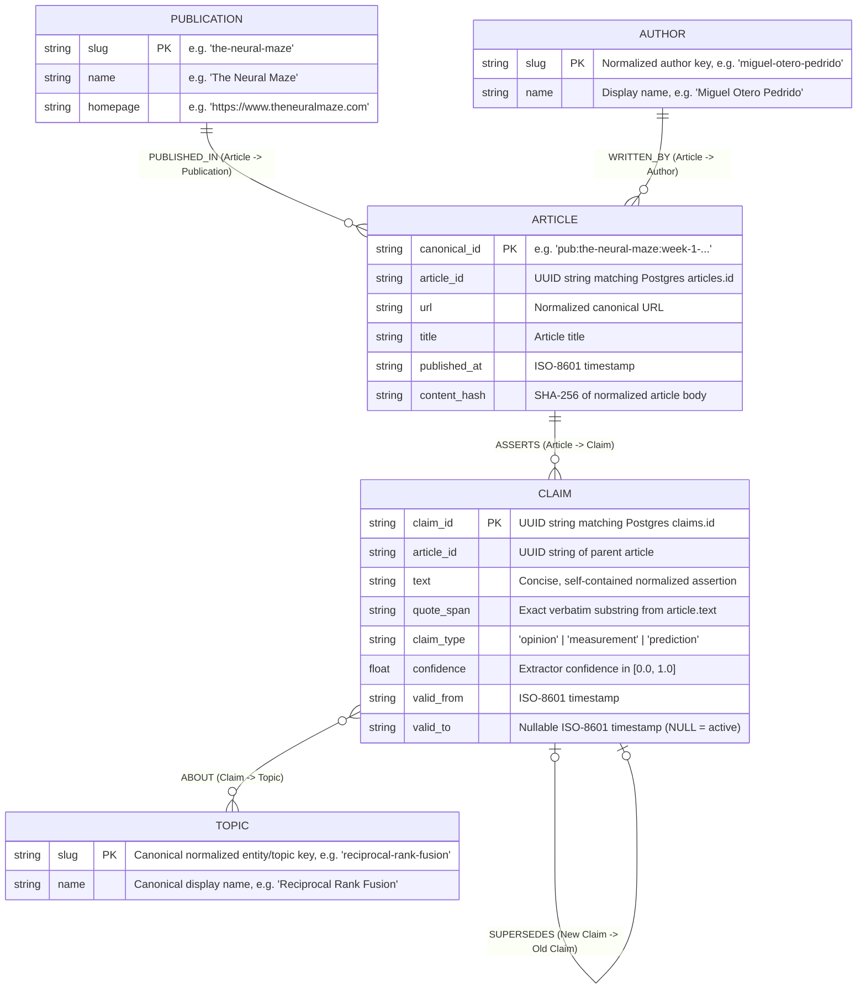
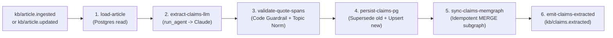

# Technical Memo: Week 4 Architecture & Implementation Plan
**Series:** The Living Knowledge Base — A 6-Week Course in Harness Engineering  
**Module:** Week 4 — Structured Claim Extraction, Graph Ontology Design, and Three-Way Retrieval Fusion  
**Authors / Maintainers:** Miguel Otero Pedrido & Antonio Zarauz Moreno (The Neural Maze)  
**Date:** October 17, 2026  
**Status:** Architectural Specification & Execution Blueprint  

---

## 1. Executive Summary

Through Week 3, the Living Knowledge Base ingests technical newsletters durably via Inngest, respects origin servers via HTTP conditional polling (`ETag` / `304 Not Modified`), preserves historical edits via temporal supersession (`valid_to`), and exposes fast reads and asynchronous writes via an 8-tool MCP server (`kb-mcp`).

However, our retrieval engine still treats knowledge as **flat bags of text passages**. While two-way Reciprocal Rank Fusion (BM25 lexical search + `pgvector` semantic similarity) excels at finding passages that match a query's vocabulary or embedding neighborhood, it cannot natively answer relational or structural questions across publications:
- *"Which authors disagree on whether agentic RAG requires a reranker?"*
- *"How have claims about test-time compute evolved across Ahead of AI, Decoding AI, and The Neural Maze?"*
- *"What concrete measurements or predictions has a specific author made about small language models?"*

In **Week 4**, we bridge this gap by extracting **attributed, quote-verified claims** from every ingested article and indexing their relationships in **Memgraph**. We then integrate graph traversal as a **third retrieval signal** alongside BM25 and vector search in our Reciprocal Rank Fusion (RRF) pipeline, and expose full claim/passage lineage via a new `kb_sources` MCP tool.

> [!IMPORTANT]
> **Architectural Mandate — Ontology Before Code:**
> Most LLM-backed knowledge graphs fail in production because teams jump straight to prompting an LLM to "extract entities and relationships" without a strict, bounded ontology. Unconstrained extraction produces node explosion, synonym fragmentation, ungrounded edges, and unqueryable spaghetti graphs. **In Week 4, designing and locking the graph ontology is Prerequisite Zero—before writing a single prompt, database migration, or Cypher query.**

---

## 2. Phase 0: The Graph Ontology & Schema Engineering (Prerequisite Zero)

### 2.1 Why Dual-Database Separation is Essential
A foundational principle of this architecture is **strict separation of concerns between PostgreSQL and Memgraph**:
1. **PostgreSQL owns prose, vectors, lexical indexes, and operational state:** High-churn tabular records (`jobs`, `cursors`, `costs`, `snapshots`, `failures`), full article bodies (`articles.text`), chunked prose (`passages.text`), `tsvector` GIN indexes, and `pgvector` HNSW indexes live exclusively in Postgres.
2. **Memgraph owns structure, attribution topology, and multi-hop traversal:** Memgraph stores only the structural skeleton of publications, authors, articles, verified claims, and canonical topics. **Passage text never enters Memgraph.**

### 2.2 Common Failure Modes of Naive Graph RAG (What Our Ontology Prevents)
Before defining our nodes and edges, we explicitly design against four classic failure modes:
1. **Unbounded Schema Drift:** Letting the LLM invent arbitrary node labels (`:Framework`, `:Company`, `:Benchmark`, `:Idea`) or arbitrary edge types (`:USES`, `:CRITICIZES`, `:IMPROVES_UPON`). Cypher queries become impossible to write deterministically when edge types are open-ended.
2. **Entity/Topic Synonym Fragmentation:** Creating separate nodes for `"RAG"`, `"rag"`, `"Retrieval-Augmented Generation"`, and `"Retrieval Augmented Generation"`. If two newsletters refer to the same concept with slight surface variations and land on disconnected nodes, cross-publication traversal completely fails.
3. **Hallucinated Attribution:** Storing an LLM-extracted claim in the graph that the author never actually wrote, or paraphrasing an author's nuanced opinion into an absolute statement without a verifiable link to the source text.
4. **Write-Time Interpretation Bias (`:CONTRADICTS` / `:SUPPORTS` edges):** Attempting to classify whether Claim A contradicts Claim B at ingestion time requires $O(N^2)$ comparisons and forces brittle, context-free LLM judgments into permanent graph edges. Instead, our ontology connects claims neutrally through shared `:Topic` nodes and defers nuance/disagreement synthesis to query time (`ask`).

---

### 2.3 Formal Ontology Specification (Locked: 5 Node Labels, 5 Edge Types)

The ontology is strictly closed. No additional node labels or relationship types may be introduced.



#### A. Node Labels & Invariant Properties

| Node Label | Primary / Merge Key | Required Properties | Nullable Properties | Ontology Invariants |
| :--- | :--- | :--- | :--- | :--- |
| **`:Publication`** | `slug` (`str`) | `slug`, `name`, `homepage` | — | 1:1 with `publications.yaml` and Postgres `publications.slug`. |
| **`:Author`** | `slug` (`str`) | `slug`, `name` | — | `slug` is deterministically slugified from normalized author name (`"Miguel Otero Pedrido"` $\rightarrow$ `"miguel-otero-pedrido"`). Fallback `"unknown-author"` if RSS/HTML lacks byline. |
| **`:Article`** | `canonical_id` (`str`) | `canonical_id`, `article_id`, `url`, `title`, `published_at`, `content_hash` | — | 1:1 with Postgres `articles.canonical_id`. Holds metadata only—never full text or passage chunks. |
| **`:Claim`** | `claim_id` (`str`) | `claim_id`, `article_id`, `text`, `quote_span`, `claim_type`, `confidence`, `valid_from` | `valid_to` (`str \| None`) | 1:1 with Postgres `claims.id`. `claim_type` $\in$ `{"opinion", "measurement", "prediction"}`. `quote_span` **must** be verified as an exact substring of `articles.text` in Python before persistence. Active claims have `valid_to IS NULL`. |
| **`:Topic`** | `slug` (`str`) | `slug`, `name` | — | Normalized entity/concept hub that bridges claims across articles and publications. |

#### B. Edge Types (Relationships), Directionality, & Semantics

| Relationship | Source $\rightarrow$ Target | Cardinality | Edge Properties | Semantic Meaning & Traversal Role |
| :--- | :--- | :--- | :--- | :--- |
| **`[:PUBLISHED_IN]`** | `(:Article)-[:PUBLISHED_IN]->(:Publication)` | $N : 1$ | None | Binds an article to its newsletter source. Enables filtering or grouping claims by publication. |
| **`[:WRITTEN_BY]`** | `(:Article)-[:WRITTEN_BY]->(:Author)` | $N : M$ | None | Binds an article to its author(s). Enables traversing all assertions made by a specific writer over time. |
| **`[:ASSERTS]`** | `(:Article)-[:ASSERTS]->(:Claim)` | $1 : N$ | None | Connects a source article to each verified claim extracted from it. |
| **`[:ABOUT]`** | `(:Claim)-[:ABOUT]->(:Topic)` | $N : M$ | None | Connects a claim to $1..K$ canonical topics/entities. **This is the primary bridge for 2-hop cross-publication retrieval.** |
| **`[:SUPERSEDES]`** | `(:Claim)-[:SUPERSEDES]->(:Claim)` | $1 : 1$ (or $N : M$ on revision) | `at` (`str`, ISO-8601) | Directed from the **newer** claim (`valid_to IS NULL`) to the **older**, invalidated claim (`valid_to IS NOT NULL`) when an article edit alters or replaces an assertion. |

---

### 2.4 Topic & Entity Normalization Rules (Preventing Graph Fragmentation)

A graph is only useful if claims from different newsletters converge on the same `:Topic` nodes. Because our corpus (*The Neural Maze*, *Decoding AI*, *Ahead of AI*) was curated for topical overlap, we must enforce **deterministic topic canonicalization** in Python (`kb/graph/canonicalize.py` or `kb/schemas/entities.py`) before any `:Topic` node is merged:

1. **Canonical Alias Table (Controlled Vocabulary for Core Domain Entities):**
   Maintain an explicit, extensible alias map in `kb/config.py` (or `kb/graph/ontology.py`) for common AI engineering synonyms and acronyms:
   - `"rag"`, `"retrieval augmented generation"`, `"retrieval-augmented generation"` $\rightarrow$ `slug="rag"`, `name="RAG"`
   - `"rrf"`, `"reciprocal rank fusion"` $\rightarrow$ `slug="reciprocal-rank-fusion"`, `name="Reciprocal Rank Fusion"`
   - `"llm"`, `"llms"`, `"large language model"`, `"large language models"` $\rightarrow$ `slug="llm"`, `name="LLM"`
   - `"mcp"`, `"model context protocol"` $\rightarrow$ `slug="mcp"`, `name="Model Context Protocol (MCP)"`
   - `"pgvector"` $\rightarrow$ `slug="pgvector"`, `name="pgvector"`
   - `"inngest"` $\rightarrow$ `slug="inngest"`, `name="Inngest"`
   - `"memgraph"` $\rightarrow$ `slug="memgraph"`, `name="Memgraph"`
2. **Deterministic Slugification Pipeline:**
   For any entity not in the explicit alias map:
   - Strip leading/trailing whitespace and surrounding punctuation.
   - Normalize Unicode (NFKC) and convert to lowercase.
   - Collapse internal whitespace and hyphens into single hyphens (`re.sub(r"[^a-z0-9]+", "-", raw.lower()).strip("-")`).
   - De-pluralize simple trailing `"s"` on multi-character technical nouns where appropriate (e.g., `"embedding models"` $\rightarrow$ `"embedding-model"`), or enforce singular noun phrases in the extraction prompt and Pydantic validator.
   - Reject overly generic stop-topics (`"ai"`, `"system"`, `"code"`, `"article"`, `"author"`, `"data"`, `"model"`) via a blocklist so `:Topic` nodes never become high-degree "supernode" hairballs that connect every claim in the database.

---

### 2.5 Claim Taxonomy (`claim_type`)

Every `:Claim` node is classified into one of three mutually exclusive epistemic types:
1. **`measurement`**: Empirical observations, benchmark results, latency/cost figures, or concrete system behaviors (e.g., *"Conditional HTTP 304 polling completes in under 15ms and emits zero downstream events"*).
2. **`opinion`**: Architectural recommendations, design principles, trade-off judgments, or best-practice assertions (e.g., *"Fast user-facing reads like `ask` should bypass workflow orchestration and query Postgres directly"*).
3. **`prediction`**: Forward-looking statements or forecasts about where models, tooling, or engineering practices are heading (e.g., *"Standardized protocols like MCP will replace custom per-editor tool wrappers"*).

Why this matters: In Week 5 (Error Analysis & Evals), one of our core failure taxonomy codes is `opinion_as_fact` (presenting an author's opinion as an empirical measurement). Encoding `claim_type` in the ontology at Week 4 gives the `ask` synthesizer and Week 5 evaluators explicit epistemic metadata.

---

### 2.6 Temporal Validity & Supersession in the Ontology

Just as Week 3 outlawed `DELETE` on `passages`, Week 4 outlaws `DELETE` on `claims` (both in PostgreSQL and Memgraph):
- Every active `:Claim` has `valid_to = null`.
- Every read traversal query in `kb/graph/cypher.py` **must** include `WHERE c.valid_to IS NULL`.
- When `kb/article.updated` triggers `extract-claims`:
  1. All currently active claims for `article_id` have their `valid_to` set to the current UTC timestamp in both PostgreSQL and Memgraph.
  2. Newly extracted and quote-validated claims are inserted with `valid_from = now()` and `valid_to = null`.
  3. If a new claim replaces a prior claim on the same topic within that article, a `(:Claim {claim_id: $new_id})-[:SUPERSEDES {at: $now}]->(:Claim {claim_id: $old_id})` edge is merged in Memgraph (and `supersedes_id` is populated in PostgreSQL).

---

### 2.7 Memgraph Indexes, Constraints, & Idempotency Rules

Before any ingestion runs against Memgraph, `kb/graph/client.py` ensures the following schema indexes and constraints exist (idempotently executed on startup/health check):

```cypher
// Label-property indexes for O(1) MERGE and lookup performance
CREATE INDEX ON :Publication(slug);
CREATE INDEX ON :Author(slug);
CREATE INDEX ON :Article(canonical_id);
CREATE INDEX ON :Article(article_id);
CREATE INDEX ON :Claim(claim_id);
CREATE INDEX ON :Claim(article_id);
CREATE INDEX ON :Topic(slug);

// Uniqueness constraints
ASSERT (p:Publication) IS UNIQUE ON (slug);
ASSERT (a:Author) IS UNIQUE ON (slug);
ASSERT (art:Article) IS UNIQUE ON (canonical_id);
ASSERT (c:Claim) IS UNIQUE ON (claim_id);
ASSERT (t:Topic) IS UNIQUE ON (slug);
```

**Three Non-Negotiable Cypher Rules (`kb/graph/cypher.py`):**
1. **100% Parameterized Cypher:** Never interpolate strings (`f"..."` or `.format()`) into Cypher statements. Always pass `$slug`, `$canonical_id`, `$claims`, etc.
2. **`MERGE`, Never `CREATE`:** Every node and relationship write must use `MERGE` on the node's primary key followed by `ON CREATE SET` / `SET`, guaranteeing that re-running `extract-claims` on the same event produces **zero duplicate nodes and zero duplicate edges**.
3. **Explicit `valid_to IS NULL` Filtering:** Every retrieval query must filter `WHERE c.valid_to IS NULL`.

---

## 3. Phase 1: Relational Storage & Event Contract Extensions

### 3.1 PostgreSQL `claims` Table (`kb/db/models.py` & Alembic Migration)

While Memgraph holds the traversal topology, PostgreSQL remains the system of record for relational joins, snapshots, and auditability. We add the `Claim` model to [`kb/db/models.py`](file:///Users/hedrergudene/Documents/GitHub/tnm-articles/articles/inngest-series/20261014/deployment/kb/db/models.py):

```python
class Claim(Base):
    """An attributed assertion extracted from an article, verified against a
    verbatim quote_span in the article text. Temporal validity mirrors Passage:
    active claims have `valid_to IS NULL`; superseded claims retain history.
    """

    __tablename__ = "claims"
    __table_args__ = (
        Index("ix_claims_article_active", "article_id", postgresql_where=text("valid_to IS NULL")),
    )

    id: Mapped[uuid.UUID] = mapped_column(UUID(as_uuid=True), primary_key=True, default=uuid.uuid4)
    article_id: Mapped[uuid.UUID] = mapped_column(
        UUID(as_uuid=True), ForeignKey("articles.id"), nullable=False
    )
    text: Mapped[str] = mapped_column(Text, nullable=False)
    quote_span: Mapped[str] = mapped_column(Text, nullable=False)
    claim_type: Mapped[str] = mapped_column(String, nullable=False)  # opinion | measurement | prediction
    entities: Mapped[list[dict[str, str]]] = mapped_column(JSONB, nullable=False, default=list)
    confidence: Mapped[float] = mapped_column(Numeric(4, 3), nullable=False, default=1.0)
    valid_from: Mapped[datetime] = mapped_column(
        DateTime(timezone=True), server_default=func.now(), nullable=False
    )
    valid_to: Mapped[datetime | None] = mapped_column(DateTime(timezone=True), nullable=True)
    supersedes_id: Mapped[uuid.UUID | None] = mapped_column(
        UUID(as_uuid=True), ForeignKey("claims.id"), nullable=True
    )
```

- **Deterministic Claim UUIDs (`uuid5`) for Idempotent Retries:**
  To make claim extraction idempotent across retries of the same article version, compute each claim's `id` deterministically via `uuid.uuid5( ARTICLE_CLAIM_NAMESPACE, f"{article_id}:{content_hash}:{normalized_quote_span}:{normalized_claim_text}" )`. If a step retries, `UPSERT` in Postgres and `MERGE (c:Claim {claim_id: $claim_id})` in Memgraph converge on the exact same UUID!

### 3.2 Event Contract Additions (`kb/schemas/events.py`)

Extend [`kb/schemas/events.py`](file:///Users/hedrergudene/Documents/GitHub/tnm-articles/articles/inngest-series/20261014/deployment/kb/schemas/events.py) with the Week 4 event:

```python
CLAIMS_EXTRACTED = "kb/claims.extracted"

class ClaimsExtracted(BaseModel):
    """enrich -> downstream listeners / telemetry. Summarizes claim extraction and quote guardrail."""

    article_id: UUID
    canonical_id: str
    claim_count: int
    dropped_spans: int
```

### 3.3 Domain & Extraction Schemas (`kb/schemas/entities.py`)

Create `kb/schemas/entities.py` with strict Pydantic v2 models for the boundary between the LLM extractor, the quote-span validator, and the database writers:

```python
from typing import Literal
from pydantic import BaseModel, Field

ClaimType = Literal["opinion", "measurement", "prediction"]

class ExtractedTopic(BaseModel):
    slug: str = Field(description="Normalized lowercase hyphenated topic slug")
    name: str = Field(description="Canonical human-readable topic or entity name")

class RawExtractedClaim(BaseModel):
    claim_text: str = Field(description="Concise, self-contained assertion attributed to the author")
    quote_span: str = Field(description="Exact verbatim substring from the article supporting the claim")
    claim_type: ClaimType
    entities: list[str] = Field(min_length=1, max_length=5, description="1 to 5 key technical entities/topics")
    confidence: float = Field(ge=0.0, le=1.0, default=0.9)

class ClaimExtractionBatch(BaseModel):
    claims: list[RawExtractedClaim] = Field(default_factory=list)
```

---

## 4. Phase 2: The Hand-Written Agent Layer (`kb/agents/`)

Per Principle 7 of [`BUILD_SPEC.md`](file:///Users/hedrergudene/Documents/GitHub/tnm-articles/articles/inngest-series/project_context/docs/BUILD_SPEC.md#L29), **no agent frameworks (LangChain, LangGraph, CrewAI, etc.) are permitted**. The agent machinery is teaching material and must be written directly from Inngest step primitives in ~200 lines of transparent Python.

### 4.1 Module Structure
- **`kb/agents/core.py`**:
  - `@dataclass(frozen=True) class Agent[T: BaseModel]`: holds `name: str`, `role: str`, `system_prompt: str`, `model: str`, `output_schema: type[T] | None = None`, `max_tokens: int = 2048`.
  - `async def run_agent(step: inngest.Step, agent: Agent[T], user_input: str, step_id: str, article_id: UUID | None = None) -> T | str`:
    - Wraps **one** LLM call inside `await step.run(step_id, _call)` so the LLM output is durably memoized by Inngest.
    - Validates structured output against `agent.output_schema` using Pydantic v2 (`model_validate_json` or Anthropic tool-use / structured JSON output).
  - `async def bounded_loop(...)`: Reusable primitive for bounded multi-step agent execution with hard iteration, call, and USD cost caps (used lightly here if needed and centrally in Week 6's researcher).
- **`kb/agents/providers.py`**:
  - Thin async wrappers around `anthropic.AsyncAnthropic` (and optional OpenAI fallback).
  - Extracts `input_tokens`, `output_tokens`, and model pricing to write a row into the Postgres `costs` table (`article_id`, `model`, `input_tokens`, `output_tokens`, `est_usd`) on every invocation.
- **`kb/agents/prompts.py`**:
  - All system prompts stored as named module-level constants (`CLAIM_EXTRACTOR_SYSTEM_PROMPT`, `ASK_SYNTHESIZER_SYSTEM_PROMPT`, `QUERY_ENTITY_SEEDER_PROMPT`).
- **`kb/agents/roles/extractor.py`**:
  - Defines the `claim_extractor_agent` configured with `CLAIM_EXTRACTOR_SYSTEM_PROMPT` and `ClaimExtractionBatch`.

---

## 5. Phase 3: Durable Claim Extraction & The Quote-Span Guardrail (`kb/functions/enrich.py`)

### 5.1 Function Definition & Triggers
Create `kb/functions/enrich.py` registering `extract-claims`, and wire it into `kb/functions/__init__.py` so `inngest.fast_api.serve` exposes it:

- **Function ID:** `extract-claims`
- **Triggers:** Dual event triggers:
  - `inngest.TriggerEvent(event=ARTICLE_INGESTED)`
  - `inngest.TriggerEvent(event=ARTICLE_UPDATED)`
- **Flow Control:**
  - `concurrency` keyed by `event.data.canonical_id` (limit `1`) so concurrent updates to the same article serialize cleanly, plus a global concurrency/throttle cap to respect Anthropic rate limits.
  - `retries=3`.

### 5.2 Step-by-Step Durable Pipeline



1. **Step 1 (`load-article`)**: Fetch the `Article` and its parent `Publication` from Postgres by `article_id`. If the article does not exist or text is empty, return early.
2. **Step 2 (`extract-claims-llm`)**: Call `run_agent` with `claim_extractor_agent` on the article title, author, publication, and body text. Returns serialized `ClaimExtractionBatch`.
3. **Step 3 (`validate-quote-spans` — The First Free Guardrail)**:
   - Pure, deterministic Python validation function (`validate_and_normalize_claims(article_text, raw_claims)`):
   - **Verbatim Check:** For each `RawExtractedClaim`, verify that `claim.quote_span` (after normalizing consecutive whitespace `[ \t\r\n]+` to a single space, while preserving exact words and punctuation) appears **verbatim** inside `article.text`.
   - If `quote_span` is empty, shorter than 15 characters, or **does not appear verbatim in `article.text`**, **drop the claim immediately** and increment `dropped_spans`.
   - **Topic Canonicalization:** Normalize `claim.entities` via Phase 0's canonicalizer into `list[ExtractedTopic]`, filtering out stop-topics. If a claim has zero valid topics after filtering, drop it or assign the article's primary topic.
   - Compute the deterministic `claim_id` (`uuid5`).
4. **Step 4 (`persist-claims-pg`)**:
   - Inside an async Postgres transaction:
   - If triggered by `kb/article.updated` (or if active claims from an older hash exist), call `supersede_claims_for_article(session, article_id)` which sets `valid_to = func.now()` on previous active claims and maps `supersedes_id` where topics overlap.
   - Upsert the validated claims into the `claims` table (`ON CONFLICT (id) DO UPDATE`).
5. **Step 5 (`sync-claims-memgraph`)**:
   - Execute parameterized Cypher via `kb/graph/client.py`:
     1. `MERGE` `:Publication`, `:Author`, and `:Article` nodes and their `[:PUBLISHED_IN]` / `[:WRITTEN_BY]` edges.
     2. If updating, set `c.valid_to = $now` on any `:Claim` connected to `:Article` whose `claim_id` is not in the new active set, and `MERGE` `[:SUPERSEDES]` edges where applicable.
     3. `UNWIND $claims AS claim`: `MERGE (c:Claim {claim_id: claim.claim_id})`, set properties, `MERGE (art)-[:ASSERTS]->(c)`, and `UNWIND claim.topics AS topic`: `MERGE (t:Topic {slug: topic.slug})`, `ON CREATE SET t.name = topic.name`, `MERGE (c)-[:ABOUT]->(t)`.
6. **Step 6 (`emit-claims-extracted`)**:
   - Emit `kb/claims.extracted` with `{article_id, canonical_id, claim_count, dropped_spans}`.

---

## 6. Phase 4: Memgraph Infrastructure & Graph Client (`infra/` & `kb/graph/`)

### 6.1 Docker Compose Additions (`infra/docker-compose.yml`)
Add two services to `infra/docker-compose.yml`:
1. **`memgraph`**:
   - Image: `memgraph/memgraph-mage:latest` (or `memgraph/memgraph-platform` / `memgraph/memgraph:latest`)
   - Ports: `7687:7687` (Bolt protocol), `7444:7444` (monitoring)
   - Volumes: named volume `memgraph_data:/var/lib/memgraph` for persistence across restarts
   - Healthcheck: `nc -z localhost 7687` (or `mgconsole` ping)
2. **`memgraph-lab`**:
   - Image: `memgraph/lab:latest`
   - Ports: `3000:3000` (Web UI for on-camera visual graph exploration)
   - Environment: `QUICK_CONNECT_MG_HOST=memgraph`, `QUICK_CONNECT_MG_PORT=7687`

### 6.2 Configuration (`kb/config.py` & `.env.example`)
Add to `Settings` in `kb/config.py`:
- `memgraph_uri: str = "bolt://localhost:7687"`
- `memgraph_user: str = ""`
- `memgraph_password: str = ""`
- `extraction_model: str = "claude-sonnet-4-20250514"` (or current configured Anthropic model)
- `extraction_max_tokens: int = 4096`
- `graph_retrieval_limit: int = 15`

### 6.3 Graph Client & Health Check (`kb/graph/client.py` & `kb/health.py`)
- Add `neo4j>=5.20` to `pyproject.toml` dependencies (Memgraph uses the official `neo4j` Python Bolt `AsyncGraphDatabase.driver`).
- `kb/graph/client.py`:
  - Manages the singleton `AsyncDriver` instance (`get_graph_driver()`, `close_graph_driver()`).
  - `ensure_graph_schema()`: runs the index and constraint statements from §2.7.
  - `check_memgraph_health() -> str`: runs `RETURN 1 AS ok` and returns `"ok"` or `"error: <detail>"`.
- Update `kb/health.py` (`GET /health` and `kb_health()`) to report `"memgraph": "ok"` alongside `"database"` and `"inngest"`, plus total active claim and topic counts.

---

## 7. Phase 5: Three-Way Hybrid Retrieval Fusion & Disagreement Synthesis

### 7.1 The Hard Retrieval Problem: Reconciling a Source with No Natural Score
- **BM25 (`sparse.py`)** returns a lexical `ts_rank` score.
- **pgvector (`dense.py`)** returns a cosine similarity score.
- **Memgraph (`graph.py`)** performs structural traversal—it has **no native similarity score**.

**Why Reciprocal Rank Fusion (RRF) is the Ideal Mechanism:**
Because RRF depends **only on ordinal rank position** ($1, 2, \dots, N$) within each engine rather than raw score magnitude:
$$\text{RRF\_score}(p) = \sum_{e \in \{\text{bm25}, \text{vector}, \text{graph}\}} \frac{1}{k + \text{rank}_e(p)}$$
we only need `kb/retrieval/graph.py` to produce a **deterministic ordinal ranking** of candidate passages/claims discovered via graph traversal!

### 7.2 How `kb/retrieval/graph.py` Works
Given a user query $Q$:
1. **Seed Topic Extraction (Fast & Deterministic First, Optional LLM Fallback):**
   - Tokenize $Q$, apply the exact same normalization & alias resolution from §2.4, and match against existing `:Topic` slugs/names in Memgraph (`WHERE t.slug IN $seed_slugs OR toLower(t.name) CONTAINS $term`).
2. **Multi-Hop Cypher Traversal:**
   - Traverse from matched `:Topic` nodes to active `:Claim` nodes (`WHERE c.valid_to IS NULL`), their parent `:Article` and `:Author`/`Publication`, and **co-occurring `:Topic` neighbors** (claims across other publications about the same topic):
   ```cypher
   MATCH (t:Topic)<-[:ABOUT]-(c:Claim)<-[:ASSERTS]-(art:Article)-[:PUBLISHED_IN]->(pub:Publication)
   WHERE t.slug IN $topic_slugs AND c.valid_to IS NULL
   OPTIONAL MATCH (art)-[:WRITTEN_BY]->(au:Author)
   RETURN c.claim_id AS claim_id,
          c.article_id AS article_id,
          c.text AS claim_text,
          c.quote_span AS quote_span,
          c.claim_type AS claim_type,
          c.confidence AS confidence,
          art.title AS title,
          art.url AS url,
          art.published_at AS published_at,
          au.name AS author,
          pub.slug AS publication_slug,
          count(DISTINCT t) AS matched_topics
   ORDER BY matched_topics DESC, c.confidence DESC, art.published_at DESC, c.claim_id ASC
   LIMIT $limit
   ```
3. **Mapping Graph Claims to Retrievable Passages (and Enriched Context):**
   - For each traversed `:Claim`, resolve the active Postgres `Passage` from `c.article_id` that contains `c.quote_span` (or carry the verified claim + verbatim quote + article passage into RRF) and attach the structured claim metadata (`claim_id`, `claim_type`, `quote_span`, `matched_topics`) so both RRF fusion and the `ask` synthesizer receive the passage and its connected claims.

### 7.3 Upgrading `kb/retrieval/hybrid.py` to Three-Way RRF
- Update `RetrievedCandidate` in [`kb/retrieval/hybrid.py`](file:///Users/hedrergudene/Documents/GitHub/tnm-articles/articles/inngest-series/20261014/deployment/kb/retrieval/hybrid.py):
  - Add `graph_rank: int | None = None`, `claim_id: str | None = None`, `claim_text: str | None = None`, `claim_type: str | None = None`.
  - Update `source` attribution so candidates surfaced by the graph record `"graph"` (or `"bm25+graph"`, `"vector+graph"`, `"all"` / list of sources, while ensuring `"graph"` is clearly identifiable in `snapshots.retrieved` per the Week 4 Verification Gate).
- Run `search_passages_bm25`, `embed_texts` + `search_passages_dense`, and `search_graph_claims` concurrently, fuse all three ranked lists with `compute_rrf(sparse_results, dense_results, graph_results, k=rrf_k)`, and return `(fused[:limit], fused)`.

### 7.4 Surfacing Cross-Publication Disagreement in `kb/functions/ask.py`
Update `SYSTEM_PROMPT` and `_format_context` in [`kb/functions/ask.py`](file:///Users/hedrergudene/Documents/GitHub/tnm-articles/articles/inngest-series/20261014/deployment/kb/functions/ask.py):
- Include extracted claims (`claim_type`, author, publication, and verbatim `quote_span`) in the context block passed to Claude.
- Instruct the synthesizer:
  > *"When retrieved passages or claims from different authors or publications take different positions or emphasize conflicting trade-offs on the same topic, explicitly surface both perspectives and cite each author/publication inline (e.g., 'While Author A argues X [1], Author B points out Y [2]'). Only surface disagreement when the claims genuinely conflict—do not invent controversy between compatible statements."*
- Update `retriever_variant` recorded in `snapshots` to `f"hybrid_3way_rrf_k{settings.rrf_k}"`.

---

## 8. Phase 6: Provenance & MCP Surface (`kb/mcp/tools.py`)

### 8.1 New MCP Tool: `kb_sources(claim_or_passage_id)`
Add `kb_sources` (the 9th MCP tool) to [`kb/mcp/tools.py`](file:///Users/hedrergudene/Documents/GitHub/tnm-articles/articles/inngest-series/20261014/deployment/kb/mcp/tools.py) and register it in `kb/mcp/server.py`:
- **Input:** `claim_or_passage_id: str` (UUID of either a `Claim` or a `Passage`).
- **Behavior (Fast Read — Direct DB + Graph Query, Zero Inngest Run):**
  - Looks up the ID in `claims` first, then `passages`.
  - Returns full provenance:
    - `kind`: `"claim"` or `"passage"`
    - `id`: UUID string
    - `article`: `{article_id, canonical_id, title, url, published_at, content_hash}`
    - `publication`: `{slug, name, homepage}`
    - `author`: author name
    - `verbatim_quote`: `claim.quote_span` (or `passage.text`)
    - `claim_text` & `claim_type` & `confidence` & `topics` (if a claim)
    - `validity`: `{valid_from, valid_to, is_active: valid_to is None, supersedes_id}`

### 8.2 MCP Docstring Updates (Task 4.6)
- **`kb_ask`**: Update docstring to state that retrieval uses 3-way fusion (BM25 + pgvector + Memgraph claim traversal) and automatically surfaces cross-publication disagreements when authors conflict.
- **`kb_sources`**: Document clearly when an agent should call `kb_sources` instead of `kb_search` (use `kb_search` to discover relevant passages by query; use `kb_sources` when inspecting a specific `claim_id` or `passage_id` from a citation to verify its exact verbatim quote, author, publication date, and temporal validity status).

---

## 9. Phase 7: Testing, Review Checkpoint, & Verification Gate

### 9.1 Required Test Suite
| Test File | Type | What It Rigorously Verifies |
| :--- | :--- | :--- |
| `tests/unit/test_ontology.py` | Unit | Entity/topic normalization collapses `"RAG"`, `"rag"`, `"Retrieval-Augmented Generation"` to a single `:Topic` slug (`"rag"`), rejects stop-topics, and enforces `claim_type` enum bounds. |
| `tests/unit/test_quote_span.py` | Unit | Exact and whitespace-normalized verbatim substrings pass; fabricated, paraphrased, or truncated non-verbatim spans are rejected and counted in `dropped_spans`. |
| `tests/unit/test_rrf_three_way.py` | Unit | 3-way `compute_rrf(sparse, dense, graph)` produces deterministic ordering and accurately tags `graph`-sourced candidates. |
| `tests/integration/test_enrich_memgraph.py` | Integration | Running `extract-claims` writes rows to Postgres `claims` and merges `:Publication`, `:Author`, `:Article`, `:Claim`, `:Topic` into Memgraph. Re-running the identical event creates **zero** duplicate nodes or edges. Editing the article (`kb/article.updated`) sets `valid_to` on old claims and creates `[:SUPERSEDES]` edges. |
| `tests/integration/test_graph_fusion.py` | Integration | A query spanning two publications connected via a shared `:Topic` in Memgraph returns a `snapshots.retrieved` JSONB list containing `"graph"`-sourced candidates alongside `"bm25"` and `"vector"`, and `kb_sources` resolves the cited claim ID to its verbatim quote. |

### 9.2 Pre-Gate Code Review Checkpoint (§2d of `BUILD_SPEC.md`)
Before running the final verification gate, run a read-only review pass scoped to `kb/graph/`, `kb/functions/enrich.py`, and `kb/retrieval/graph.py` checking specifically for:
1. Any un-parameterized Cypher string interpolation.
2. Any use of `CREATE` instead of `MERGE` in `kb/graph/cypher.py`.
3. Any graph read query missing `WHERE c.valid_to IS NULL`.
4. Confirming quote-span validation is enforced deterministically in Python code before database/graph persistence—never trusted from the LLM output.

### 9.3 Week 4 Verification Gate & On-Camera Demo Checklist

```bash
# 1. Start full stack (Postgres + Inngest Dev Server + Memgraph + Memgraph Lab)
make start
uv run alembic upgrade head
make check

# 2. Trigger claim extraction across the ingested corpus & verify zero duplicates on replay
# Confirm in Inngest UI (localhost:8288) that extract-claims completed and emitted kb/claims.extracted

# 3. Query across publications via MCP / FastAPI
# Ask a question where two publications' claims connect through a shared Topic entity:
curl -X POST http://localhost:8000/ask \
  -H "Content-Type: application/json" \
  -d '{"question": "How should engineers design RAG retrieval and agent orchestration in production?"}'

# 4. Verify Provenance via kb_sources
# Call kb_sources("<cited_claim_or_passage_id>") -> returns article, author, verbatim quote, valid_from/valid_to

# 5. Verify 3-Way Fusion in Postgres Snapshots
psql "$DATABASE_URL" -c "SELECT jsonb_pretty(retrieved) FROM snapshots ORDER BY created_at DESC LIMIT 1;"
# EXPECTED: candidates present from all three sources: bm25, vector, and graph

# 6. Visual Ontology & Traversal Demo in Memgraph Lab (http://localhost:3000)
```

**On-Camera Cypher Traversal for Memgraph Lab (`localhost:3000`):**
```cypher
// Traverse: Author 1 -> Article -> Claim -> Shared Topic <- Claim <- Article <- Author 2
MATCH (a1:Author)<-[:WRITTEN_BY]-(art1:Article)-[:ASSERTS]->(c1:Claim)-[:ABOUT]->(t:Topic)<-[:ABOUT]-(c2:Claim)<-[:ASSERTS]-(art2:Article)-[:WRITTEN_BY]->(a2:Author)
WHERE c1.valid_to IS NULL
  AND c2.valid_to IS NULL
  AND a1.slug <> a2.slug
RETURN a1, art1, c1, t, c2, art2, a2
LIMIT 25;
```

---

## 10. Recommended Implementation Execution Order

1. **Step 1 — Lock Ontology & Normalization (`kb/schemas/entities.py`, `kb/graph/ontology.py`, `tests/unit/test_ontology.py`):** Define the 5 node models, 5 relationship types, `ClaimType` literal, and deterministic `:Topic` / `:Author` slug canonicalizer with unit tests.
2. **Step 2 — Quote-Span Guardrail (`kb/sources/quote_validator.py`, `tests/unit/test_quote_span.py`):** Implement and unit-test deterministic verbatim substring verification before touching any LLM or DB code.
3. **Step 3 — Memgraph Container & Client (`infra/docker-compose.yml`, `kb/graph/client.py`, `kb/graph/cypher.py`):** Stand up Memgraph + Memgraph Lab, enforce indexes/constraints, write all parameterized `MERGE` and traversal queries, and wire `check_memgraph_health` into `/health` and `kb_health`.
4. **Step 4 — Postgres `claims` Migration & Queries (`kb/db/models.py`, `alembic/`, `kb/db/queries.py`, `kb/schemas/events.py`):** Add the `claims` table, `kb/claims.extracted` event schema, and idempotent upsert/supersede SQL functions.
5. **Step 5 — Hand-Written Agent Layer (`kb/agents/core.py`, `providers.py`, `prompts.py`, `roles/extractor.py`):** Implement `Agent`, `run_agent`, cost tracking, and the ontology-aligned extractor prompt.
6. **Step 6 — Durable `extract-claims` Function (`kb/functions/enrich.py`):** Wire the 6-step Inngest function triggered by `kb/article.ingested` and `kb/article.updated`.
7. **Step 7 — Three-Way Fusion & Disagreement Synthesis (`kb/retrieval/graph.py`, `hybrid.py`, `kb/functions/ask.py`):** Integrate graph candidates into RRF and update `ask` to surface cross-publication disagreements.
8. **Step 8 — `kb_sources` MCP Tool & Verification Gate (`kb/mcp/tools.py`, `tests/integration/`):** Expose provenance over MCP, run the full test suite, execute the code review checkpoint, and verify the live traversal in Memgraph Lab.


